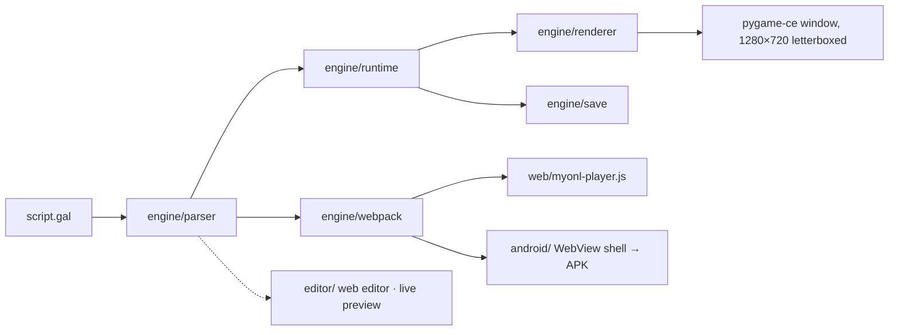

# MYONL · Phone-first Game Maker

[简体中文](README.md) | **English**


**Make a game on your phone.** Install one APK, open it, and you can create a project, write
scenes, keep everything on the device, and export it — no network, no account, no cloud.

> **Phone first, desktop assists.** The phone does the authoring: new project → dialogue /
> characters / choices → saved locally → export a self-contained HTML. The desktop does the two
> things a phone cannot: advanced presentation (voice, animation, foreground, CG, camera,
> transition, plugins), multi-file scripts, APK builds, and tests.
>
> This is an **engine/tool for creators**, not a game. The bundled sample is a starting point you
> are meant to rewrite.

## Grab something playable

| You want | Take |
| :--- | :--- |
| Android phone or tablet, installed | [**MYONL-v1.2.14.apk**](https://github.com/123456789556/myonl/releases/download/v1.2.14/MYONL-v1.2.14.apk) |
| Any browser, nothing installed | a single-file HTML you exported |
| Windows, double-click (editor + packager) | build it in-repo: `py -3 tools/build_release_zip.py` |

> **Versioning**: just install the latest — **saves never get wiped**, and you don't have to
> compare version numbers. One public series: `v1.0.0` → `v1.1.0` (a new thing you can do) →
> `v1.1.1` (a fix for something broken). Invisible work (refactors, tests, pixel nudges) does not
> take a version number. Details in [docs/版本规则.md](docs/版本规则.md).

The APK targets `minSdk` 24 (Android 7.0); one package serves phones and Android tablets and
reflows in both orientations. There is **no iOS build** — an iOS browser can open the web bundle,
but there is no iOS installer.

## Three steps to something playable

1. **Write** — open a project, type one line per beat in the center editor. Lines starting with
   `@` are directives (`@bg 教室` changes the background, `@music 名字` plays a track).
2. **Add assets** — the bottom **assets** tab: pick images and music from the gallery, or share
   them in from another app.
3. **Export** — the bottom **export** tab produces one `.html`; send it over chat or copy it to a
   computer and it opens in any browser.

## What the phone can and cannot do

**Authoring, saving, images, music, and a finished bundle — all on the device.**

- The script is parsed by `engine/parser.js`, field-for-field identical to the desktop
  `engine/parser.py` (cross-checked by `tools/pack_diff.py` against the projects in `games/`);
  `engine/pack.js` assembles the single-file HTML on the device.
- Images are downscaled to a 1280 longest edge on import; audio is stored as-is. Data lives on the
  device (images in `IndexedDB`, script in `localStorage`).
- **A real limit**: the single-file HTML inlines assets as base64 (~+37% by size). A soft warning
  starts at 40 MB and a strong warning at 80 MB (export is not blocked either way), but past 80 MB
  low-end devices most likely white-screen. A folder/zip release for larger assets is not built yet.

The phone **editor** cannot write 8 directives: `@voice`, `@anim`, `@fg`, `@cg`, `@camera`,
`@transition`, `@plug`, `@include`. Writing one raises a clear error with the line number.

> Read this as two layers, not one:
>
> - **The player supports them all.** `web/myonl-player.js` implements `cg`, `fg`, `anim`,
>   `camera`, `transition` and `voice`, so a bundle exported on the desktop plays them normally on a
>   phone — camera moves, voice, sprite easing all work.
> - **The phone editor never emits those ops.** A phone project is a single file: `@include` has no
>   second file to pull in, and `@plug` has no plugin to load.
>
> Real boundary: write them on the desktop, and the exported bundle behaves on the phone. Letting
> the phone write them too would need parsing branches in `engine/parser.js`, not a new player.
> Full boundary in [docs/手机端编游戏.md](docs/手机端编游戏.md).

## What a script looks like

```gal
@bg bg_天台
@music bgm_night

@label start
@show 林晚 微笑
@[林晚] 你又迟到了两分钟。      # square brackets = character line (no registration needed)
@ 晚风把她的发梢吹起。          # @ + space = narration
@choice:
  > 一起看日落 -> 结局_看日落
  > 说出那个约定 -> 结局_约定

@label 结局_看日落
@[[林晚]] 那年夏天，风很长。    # double brackets = full-screen monologue (NVL)
@end
```

Saves anchor on "which label, plus how many lines past it" — not line numbers — so small script
edits and new chapters keep old saves readable. The full directive set is in
[docs/engine_spec.md](docs/engine_spec.md).

## How it runs



The same `parser → runtime → asset manifest` feeds the player window, the editor preview, and
the web bundle: the preview is the real engine render, not a separate mock.

## Source development (Windows, Python 3.9+)

```powershell
pip install -r requirements.txt

# 1) Run the bundled sample
py -3 -m engine.demo games/标准示例/script.gal --assets games/标准示例

# 2) Create your own project
py -3 -m engine.cli new 我的第一个游戏

# 3) Open the web editor (http://127.0.0.1:8000)
py -3 -m engine.editor --project games/我的第一个游戏

# 4) Package a double-clickable folder (dist/<game>/)
py -3 pack.py games/我的第一个游戏

# 5) Produce the single-file web bundle
py -3 -c "from engine.webpack import build_single; build_single(r'games\我的第一个游戏', r'dist\web\游戏.html', title='游戏')"
```

### Tests and gates

```powershell
py -3 -m pytest -q -m "not slow"      # fast daily run
py -3 -m pytest -q                    # full suite incl. slow; count in the latest CHANGELOG
py -3 -m pytest -q -m slow            # real packaging / full render / perf cases
```

- Test layers: `unit` / `ui` / `integration` / `slow`; coverage gate 80% (`tools/check_coverage.ps1`)
- Type check is a ratchet: `tools/check_types.ps1` blocks new errors, does not repay the backlog
- Environment, gates and commit conventions: [docs/贡献指南.md](docs/贡献指南.md); module layout:
  [docs/架构说明.md](docs/架构说明.md)

## Sample projects (self-made, not someone else's work)

Four projects under `games/`, ready to edit:

- **教程示例** (14 files) — directives explained line by line
- **标准示例** (24 files) — a complete project: script, assets, config
- **新游戏模板** (21 files) — bare skeleton from scratch
- **newbie_demo** (7 files) — the sample packed into the app's assets; the home screen no longer
  exposes a "demo" entry (it now opens a short editable tutorial project instead)

All assets are self-made placeholders; reuse and delete freely. Someone else's game as a reference
would be redistribution and does not belong in this repo.

## Documentation

- [Quick start](docs/快速上手.md) · [Phone authoring boundary](docs/手机端编游戏.md)
- [Engine spec (full directive set)](docs/engine_spec.md) · [Asset import guide](docs/素材导入指南.md)
- [Packaging guide](docs/打包使用指南.md) · [Saves and upgrades](docs/存档与升级.md)
- [Architecture](docs/架构说明.md) · [Contributing](docs/贡献指南.md) · [Plugin guide](docs/插件开发指南.md)
- [Product rationale](docs/产品说明书.md) · [Version rules](docs/版本规则.md) · [Changelog](docs/CHANGELOG.md)

## FAQ

- **Do I need to program?** No. The script is a short set of Chinese directives. You only need
  Python if you want to modify the engine itself.
- **Does it need network?** No. Authoring, preview, packaging and play are all offline; the APK
  does not go online.
- **Mac / Linux?** The editor and packager are developed on Windows; **the player side is
  open** — any modern browser opens the web bundle, and the APK runs on Android 7.0+.
- **Separate build for tablets?** No. One APK serves phones and Android tablets; orientation
  reflows automatically, and there is only one copy of the assets.
- **3D / multiplayer?** Not done. This release is a visual novel only.
- **Will editing the script break old saves?** No. Saves anchor on label + offset, not line numbers.
- **Will an upgrade wipe saves?** No. The APK uses a fixed signature, so an in-place install keeps
  data; save export/import is the backup path.
- **How big is the output?** The APK is a shell plus player; the web bundle **scales with your
  assets** — inlined as base64 it grows ~a third, so more assets means a larger file. That is a
  real limit of this route, not a bug.
- **Built-in AI?** No. The engine exposes JSON control primitives callable by external scripts /
  AI, but the product itself contains no model.
- **Can I use the sample assets commercially?** Read `NOTICE` first; third-party assets carry
  their own terms and must not be copied wholesale.

## License

MIT (see [LICENSE](LICENSE)). Third-party components and asset terms are listed in [NOTICE](NOTICE).

> This product runs fully offline and depends on no online service.
