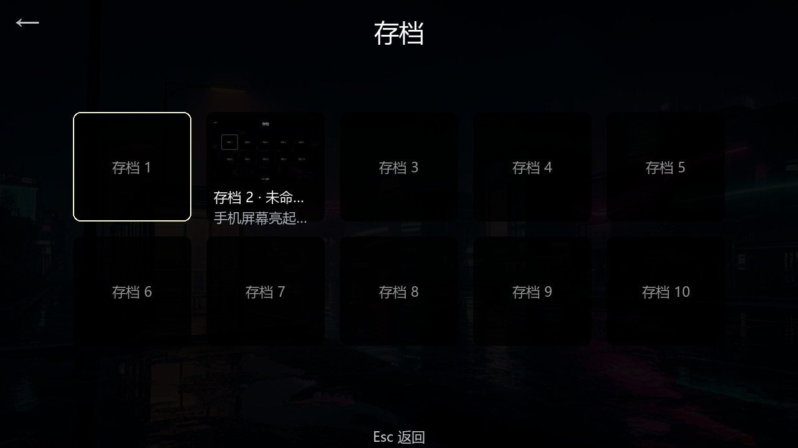
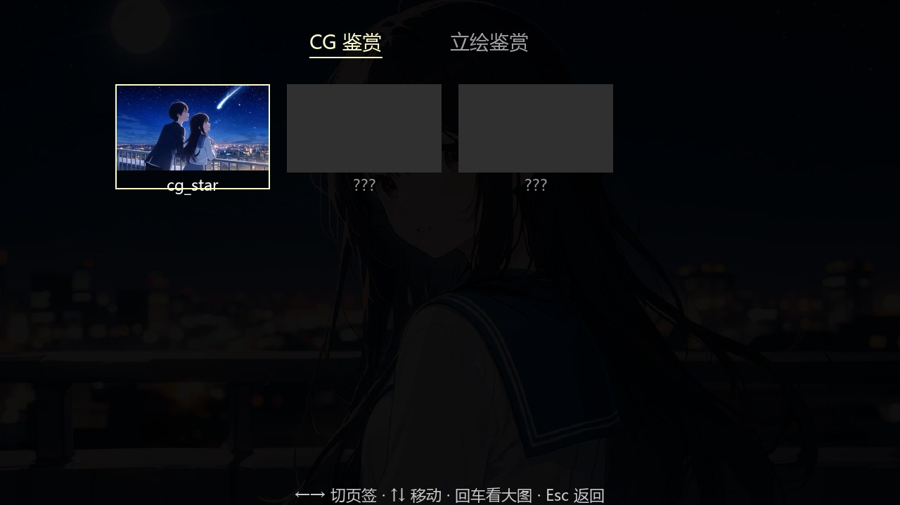
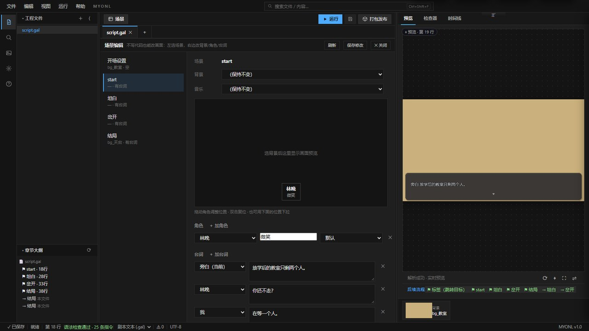
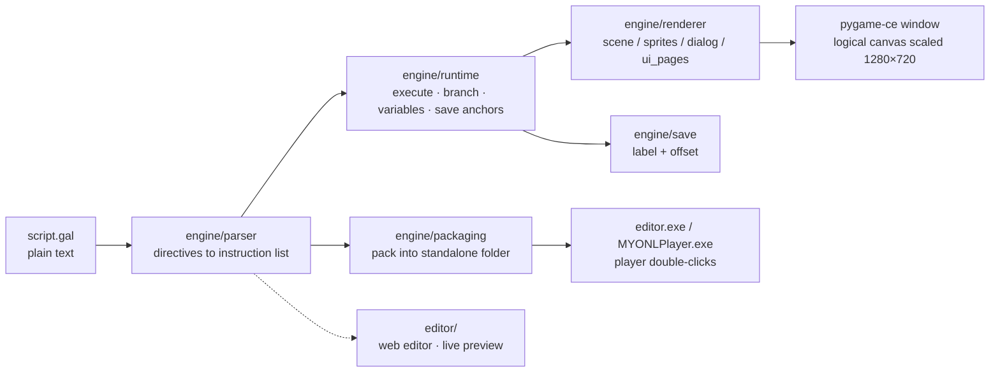

# MYONL Engine

[简体中文](README.md) | **English**


**A fully offline, MIT-licensed visual-novel engine and authoring tool for Windows.**
Write a plain-text script, preview it live, and package it into a build your players double-click — no Python on their machine, no installer, no network.

> This is an **engine/tool for creators**, not a game. The bundled sample is a starting point you are meant to rewrite.
> Windows 10 21H2+ / Windows 11 · Python 3.9+ · pygame-ce · MIT · 100% offline


## The short version

- **Write** — `script.gal` is plain text with 24 directives; any editor can open it
- **See** — the built-in web editor puts script on the left and a live preview on the right; one line change, half a second to picture
- **Ship** — one click packs a folder your player double-clicks. No Python, no config, nothing to install

The whole engine ships as a **46 MB** package (`editor.exe` + bundled runtime). That size is the point: it is small enough to hand to someone over a chat app.

## What's inside

**Player side**

- Title / continue / load / settings / gallery menus, 10 save slots + quick save, each with thumbnail and chapter name
- Typewriter dialogue, automatic pagination for long passages, branching choices, backlog
- Auto-play, skip (read-only content), hide-UI screenshot mode, fullscreen
- CG and character-art gallery with unlock progress

**Authoring side**

- 24 directives: `@bg` `@music` `@show` `@anim` `@fg` `@cg` `@camera` `@transition` `@chapter` `@choice` `@set` `@if` `@jump` `@voice` `@video` `@include` …
- Typewriter, 22 easing curves, camera pan/zoom/shake, three transitions, frame-sequence video backgrounds, voice
- Syntax checking, directive completion, drag-and-drop asset import, chapter file tree, scene timeline, UI design panel
- Hot reload: editing `.gal` replays from the current scene; editing `config.json` updates font size and colors instantly
- Configurable logical canvas (1280×720 / 1920×1080, scaled proportionally), on-demand asset loading with LRU cache

## Screens

| | |
|---|---|
|  Title: "Continue" greys out when no save exists |  Save: 10 slots + thumbnail + chapter name |
|  Gallery: CG and character-art tabs |  Editor: scene editing + live preview |

## What a script looks like

```gal
@bg bg_天台
@music bgm_night

@label start
@show 林晚 微笑
@[林晚] 你又迟到了两分钟。      # [name] = character line (no registration needed)
@ 晚风把她的发梢吹起。          # @ + space = narration
@choice:
  > 一起看日落 -> 结局_看日落
  > 说出那个约定 -> 结局_约定

@label 结局_看日落
@[[林晚]] 那年夏天，风很长。    # [[name]] = full-screen monologue (NVL)
@end
```

Saves record "which label, plus how many lines past it" — not line numbers. So editing the script or adding chapters does not invalidate existing saves.

## Language, stated plainly

The directive keywords are **Chinese** (`@bg` is ASCII, but the DSL's vocabulary and the editor UI are Chinese). This is deliberate: the engine was built for Chinese-language visual-novel authors, and the DSL is meant to read like a script in that language.

If you are looking for an engine with a fully English DSL and English editor UI, **this is not it yet.** An English-facing localization of the editor and an aliased directive set are candidates in the backlog, not shipped. What is available in English today: this README, `docs/en/quick-start.md`, and the source code's structure and tests.

## How it runs



The same `parser → runtime → renderer` pipeline serves both the player window and the editor's right-hand preview: the preview is real engine rendering, not a mockup.

## Quick start (release build, recommended)

1. Unzip `MYONL-v1.0.0-rc7-windows.zip` anywhere **outside** `Program Files` (no admin rights needed)
2. Double-click `editor/editor.exe`
3. The editor opens the bundled `games/教程示例` project; live preview is on the right

Windows 10/11 ship WebView2, so nothing else is required. If the window does not appear, install [WebView2 Runtime](https://developer.microsoft.com/microsoft-edge/webview2/) or use the source route below.

## Develop from source (Windows, Python 3.9+)

```powershell
pip install -r requirements.txt

# 1) Run the bundled sample (three-act story: hallway -> rooftop -> room)
py -3 -m engine.demo games/标准示例/script.gal --assets games/标准示例

# 2) Create your own game
py -3 -m engine.cli new 我的第一个游戏

# 3) Open the web editor (http://127.0.0.1:8000)
py -3 -m engine.editor --project games/我的第一个游戏

# 4) Pack it into a double-clickable folder (dist/<game name>/)
py -3 pack.py games/我的第一个游戏
```

Turn on hot reload while writing:

```powershell
py -3 -m engine.demo games/我的第一个游戏/script.gal --assets games/我的第一个游戏 --hot-reload
```

## Tests and gates

```powershell
py -3 -m pytest -q                    # full suite, 1021 cases (including slow, takes a while)
py -3 -m pytest -q -m "not slow"      # daily run: 988 passed + 1 skipped (~67s)
py -3 -m pytest -q -m slow            # real packaging / full render / performance cases
```

- Layers: `unit` / `ui` / `integration` / `slow`; coverage gate 80% for `engine/` (`tools/check_coverage.ps1`)
- Type-check ratchet: `tools/check_types.ps1` (blocks new errors only, does not force a burn-down)
- Interaction walkthrough: `py -3 tools/ui_walkthrough.py --game games/标准示例` (driven by real keyboard/mouse events, screenshots and asserts at every screen)

> The release zip (`editor.exe` + bundled runtime) is **not** committed to Git. Reproduce it with `build_editor.bat` and `tools/build_release_zip.py`.

## Repository layout

| Path | Contents |
|---|---|
| `engine/` | Core: parser, runtime, rendering (10 render modules), saves, editor backend, packaging |
| `editor/` | Web editor frontend (HTML/CSS/JS, no build step) |
| `games/` | Sample projects (standard / tutorial / new-game templates) |
| `tests/` | Headless pytest suite (unit / ui / integration / slow) |
| `tools/` | Gates and scripts (coverage / pyright / release verification / asset import) |
| `docs/` | Getting started, product description, engine spec, developer and packaging guides |

Documentation is written in Chinese. English coverage: this README and [`docs/en/quick-start.md`](docs/en/quick-start.md). The engine spec (`docs/engine_spec.md`) is Chinese-only for now.

## FAQ

- **Do I need to know Python?** No. The script is 24 directives. You only need Python if you want to modify the engine itself.
- **Does it need a network connection?** No. Writing, previewing, packing and playing are all offline.
- **macOS / Linux?** Windows only for now (10 21H2+ / 11). Cross-platform is in the backlog with no schedule.
- **3D / multiplayer / mobile?** No. Visual novels only; the general-purpose-engine direction is explicitly refused.
- **Will editing the script break old saves?** No. Saves anchor on label + offset, not line numbers.
- **How big is the output?** The runtime is about 46 MB and ships inside each game; the player machine needs no Python.
- **Is there built-in AI?** No. The engine exposes JSON control primitives that external scripts or AI can drive, but the product contains no model.
- **Can I use the sample assets commercially?** Read `NOTICE` first; third-party assets carry their own terms.

## License

MIT — see [LICENSE](LICENSE). Third-party components and assets: see [NOTICE](NOTICE).

> This product runs fully offline and depends on no online service.
