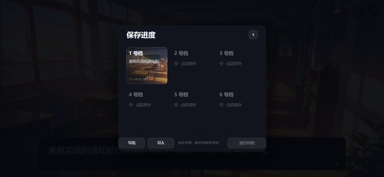
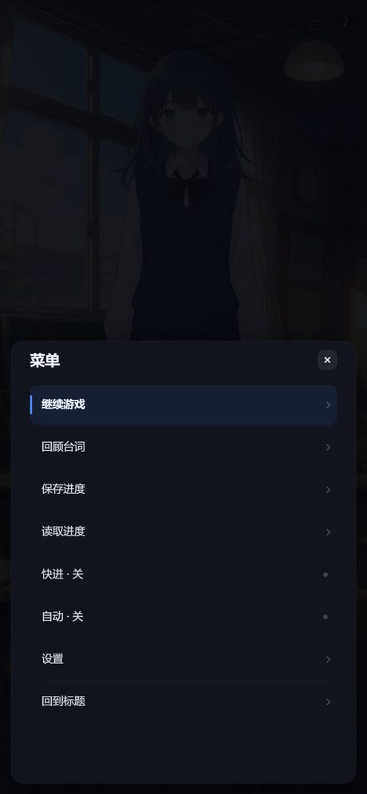
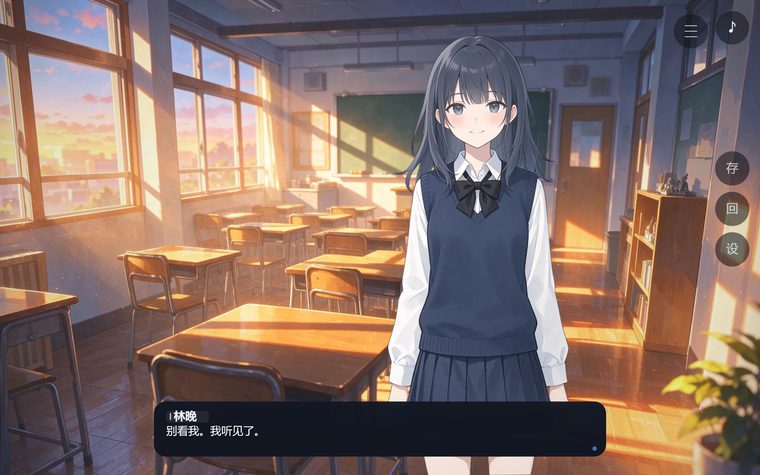
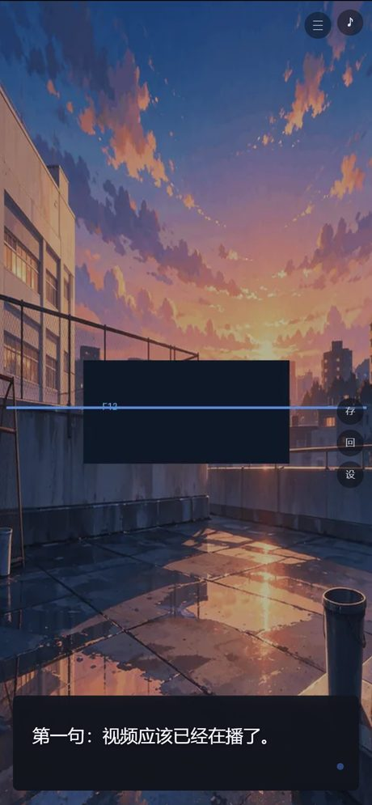
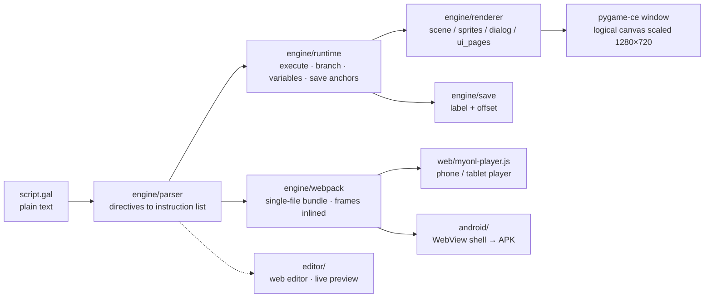

# MYONL · Phone-first Game Maker

[简体中文](README.md) | **English**


**Make a game on your phone.** Install one APK, open it, and you can create a project, write
scenes, keep everything on the device, and export it — no network, no account, no cloud.

> **Phone first, desktop assists.** The phone does the authoring: new project → dialogue / characters /
> choices → saved locally (`localStorage`) → export `.gal`. The desktop does the two things a phone
> cannot: **packaging** (`.gal` → a double-clickable single-file HTML / APK) and **bulk asset work**.
> Transfer goes over a USB cable — the phone is just a thumb drive. No LAN, no QR pairing.
>
> This is an **engine/tool for creators**, not a game. The bundled sample is a starting point you are meant to rewrite.

## Grab something playable

| You want | Take | Size |
| :--- | :--- | :--- |
| Android phone or tablet, installed | [**MYONL-apk-10.apk**](https://github.com/123456789556/myonl/releases/download/apk-10/MYONL-apk-10.apk) | 3.6 MB |
| Any browser, nothing installed | a single-file HTML you exported | ~3.0 MB |
| Windows, double-click (editor + packager) | build it in-repo: `py -3 tools\build_release_zip.py --version v1.0.0-rc21` (too big to host on Releases) | 66.5 MB |

The APK targets `minSdk` 24 (Android 7.0); one package serves phones and Android tablets and reflows
in both orientations. Saves live in the app's own storage, and the APK is signed with a fixed key —
upgrading replaces the package without wiping saves or asking you to uninstall.

## Phone and tablet first

One project, three exits: a **single-file web bundle**, an **Android APK** (self-built WebView
shell + fixed signing key, built by `.github/workflows/android-apk.yml`), and a **Windows folder**
(double-click, no Python on the player's machine).

Feeding the same code to a 390 px phone and an 800 px Android tablet is the part that needed pinning.
The logical canvas is a constant 1080 short edge, so a fixed `px` value means 17 CSS px on the phone
and 35 CSS px on the tablet — text doubles, a screen holds a dozen characters, and the whole thing
reads as "the phone layout, magnified". So the layout is pinned to **physical CSS size**:

- **Type size is back-derived from CSS**: target 18.5 CSS px → 51 logical px on a phone, 25 on a tablet;
  it lands the same size in your eye on both.
- **Body text caps at 720 CSS px** (~39 characters per line), which is what actually tames 1280×800
  and 1024×600 tablet-landscape canvases.
- **Sprite height follows the current dialogue panel**: portrait takes `min(86% screen height, panel
  top - 6)`, so a one-line line puts the character at 71% screen height on a tablet and a long line
  shrinks them back continuously. Landscape does not clamp — in galgames the character normally
  stands on the bottom edge behind the box.

Rotation tested end to end: phone 1080×2337 ↔ 2337×1080, tablet 1080×1728 ↔ 1728×1080 — scene,
background and sprites stay continuous, `panelH` recomputes, zero `pageerror`.

### `@video` frame sequences are budgeted on phones

Frames live at `images/videos/<name>_001.png` and onward (`@video <name> fps=24`). On desktop you can
cache them all; on a phone you cannot: **one 1080×1920 frame decodes to ~8 MB, so 10 s at 24 fps is
240 frames** — the first loop alone would eat 2 GB and the game goes white. The player keeps only the
**14 most recently used frames**, warms the first three on entry (otherwise the first frame is still
loading and the screen flashes black), and releases everything when `@bg` takes over.

## What's inside

**Player side**

- Title / continue / load / settings / gallery menus, 6 slots + auto save, each with a background
  thumbnail, the line you were on, and a timestamp
- Typewriter dialogue, automatic pagination for long passages, branching choices, backlog
- Auto-play, skip (read-only content), hide-UI screenshot mode, fullscreen
- Save export / import as a `MYONL1:` text code, so a slot moves between devices
- CG and character-art gallery with unlock progress

**Authoring side**

- 24 directives: `@bg` `@music` `@show` `@anim` `@fg` `@cg` `@camera` `@transition` `@chapter` `@choice` `@set` `@if` `@jump` `@voice` `@video` `@include` …
- Typewriter, 22 easing curves, camera pan/zoom/shake, three transitions, frame-sequence video backgrounds, voice
- Syntax checking, directive completion, drag-and-drop asset import, chapter file tree, scene timeline, UI design panel
- Hot reload: editing `.gal` replays from the current scene; editing `config.json` updates font size and colors instantly
- Configurable logical canvas (1280×720 / 1920×1080, scaled proportionally), on-demand asset loading with LRU cache

## Screens

| Phone portrait | Phone landscape |
|---|---|
|  |  |
|  |  |

| Android tablet |
|---|
|   |



## What a script looks like

```gal
@bg bg_天台
@music bgm_night

@label start
@show 林晚 微笑
@[林晚] 你又迟到了两分钟。      # [name] = character line (no registration needed)
@ 晚风把她的发梢吹起。          # @ + space = narration
@choice:
  > 一起看日落 -> 结局_看日落
  > 说出那个约定 -> 结局_约定

@label 结局_看日落
@[[林晚]] 那年夏天，风很长。    # [[name]] = full-screen monologue (NVL)
@end
```

Saves record "which label, plus how many lines past it" — not line numbers. So editing the script or adding chapters does not invalidate existing saves.

## Language, stated plainly

The directive keywords are **Chinese** (`@bg` is ASCII, but the DSL's vocabulary and the editor UI are Chinese). This is deliberate: the engine was built for Chinese-language visual-novel authors, and the DSL is meant to read like a script in that language.

If you are looking for an engine with a fully English DSL and English editor UI, **this is not it yet.** An English-facing localization of the editor and an aliased directive set are candidates in the backlog, not shipped. What is available in English today: this README, `docs/en/quick-start.md`, and the source code's structure and tests.

## How it runs



The same `parser → runtime → asset manifest` pipeline serves the player window, the editor's
right-hand preview, and the web bundle: the preview is real engine rendering, not a mockup.

## Quick start (release build, recommended)

1. Unzip `MYONL引擎-v1.0.0-rc21.zip` anywhere **outside** `Program Files` (no admin rights needed)
2. Double-click `editor/editor.exe`
3. The editor opens the bundled `games/教程示例` project; live preview is on the right

Windows 10/11 ship WebView2, so nothing else is required. If the window does not appear, install [WebView2 Runtime](https://developer.microsoft.com/microsoft-edge/webview2/) or use the source route below.

## Develop from source (Windows, Python 3.9+)

```powershell
pip install -r requirements.txt

# 1) Run the bundled sample (three-act story: hallway -> rooftop -> classroom)
py -3 -m engine.demo games/标准示例/script.gal --assets games/标准示例

# 2) Create your own game
py -3 -m engine.cli new 我的第一个游戏

# 3) Open the web editor (http://127.0.0.1:8000)
py -3 -m engine.editor --project games/我的第一个游戏

# 4) Pack it into a double-clickable folder (dist/<game name>/)
py -3 pack.py games/我的第一个游戏

# 5) Export the single-file web bundle (this is what phones and tablets get)
py -3 -c "from engine.webpack import build_single; build_single(r'games\我的第一个游戏', r'dist\web\game.html', title='game')"
```

Turn on hot reload while writing:

```powershell
py -3 -m engine.demo games/我的第一个游戏/script.gal --assets games/我的第一个游戏 --hot-reload
```

## Tests and gates

```powershell
py -3 -m pytest -q -m "not slow"      # daily run (~70s)
py -3 -m pytest -q                    # full suite: 1168 passed + 1 skipped
py -3 -m pytest -q -m slow            # real packaging / full render / performance cases
```

- Layers: `unit` / `ui` / `integration` / `slow`; coverage gate 80% for `engine/` (`tools/check_coverage.ps1`)
- Type-check ratchet: `tools/check_types.ps1` (blocks new errors only, does not force a burn-down)
- Interaction walkthrough: `py -3 tools/ui_walkthrough.py --game games/标准示例` (driven by real keyboard/mouse events, screenshots and asserts at every screen)
- Layout contract: `web/test/layout-smoke.js` asserts "physical type size 17.5–19.5 CSS px" and
  "≤41 characters per line" across phone portrait/landscape, tablet portrait/landscape and 1024×600

> The release zip (`editor.exe` + bundled runtime) is **not** committed to Git. Reproduce it with `build_editor.bat` and `tools/build_release_zip.py`.

## Repository layout

| Path | Contents |
|---|---|
| `engine/` | Core: parser, runtime, rendering (10 render modules), saves, editor backend, web packaging |
| `web/` | Phone / tablet player (`myonl-player.js`, `myonl-layout.js`) and layout contract tests |
| `android/` | APK project (WebView shell + fixed signing key + Gradle config) |
| `editor/` | Web editor frontend (HTML/CSS/JS, no build step) |
| `games/` | Sample projects (研修日志 / standard / tutorial / new-game templates) |
| `tests/` | Headless pytest suite (unit / ui / integration / slow) |
| `tools/` | Gates and scripts (coverage / pyright / release verification / asset import) |
| `docs/` | Getting started, product description, engine spec, save & upgrade, developer and packaging guides |

Documentation is written in Chinese. English coverage: this README and [`docs/en/quick-start.md`](docs/en/quick-start.md). The engine spec (`docs/engine_spec.md`) is Chinese-only for now.

## FAQ

- **Do I need to know Python?** No. The script is 24 directives. You only need Python if you want to modify the engine itself.
- **Does it need a network connection?** No. Writing, previewing, packing and playing are all offline.
- **macOS / Linux?** The editor and packager are Windows-only for now. **The player side is not**: the web bundle runs in any modern browser, the APK runs on Android 7.0+.
- **Do tablets need a separate build?** No. One APK serves phones and Android tablets; assets are shared and the layout reflows.
- **3D / multiplayer?** No. Visual novels only; the general-purpose-engine direction is explicitly refused.
- **Will editing the script break old saves?** No. Saves anchor on label + offset, not line numbers.
- **Does upgrading wipe saves?** No. The APK is signed with a fixed key and upgraded in place; saves stay in the app's storage, and export/import is the fallback.
- **How big is the output?** ~46 MB for the Windows runtime, ~3 MB for a single-file web bundle (assets inlined), ~3.8 MB for the APK.
- **Is there built-in AI?** No. The engine exposes JSON control primitives that external scripts or AI can drive, but the product contains no model.
- **Can I use the sample assets commercially?** Read `NOTICE` first; third-party assets carry their own terms.

## License

MIT — see [LICENSE](LICENSE). Third-party components and assets: see [NOTICE](NOTICE).

> This product runs fully offline and depends on no online service.
