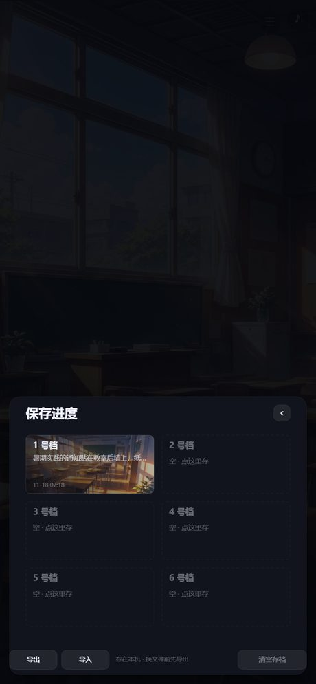
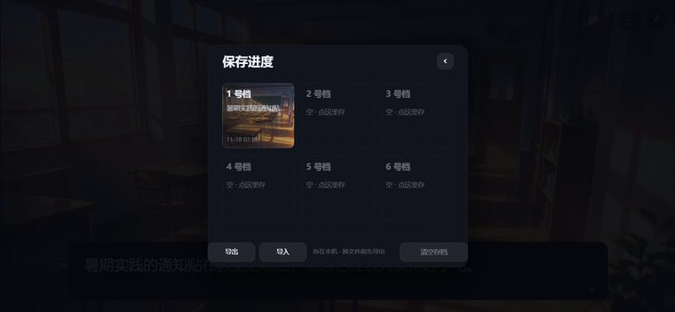
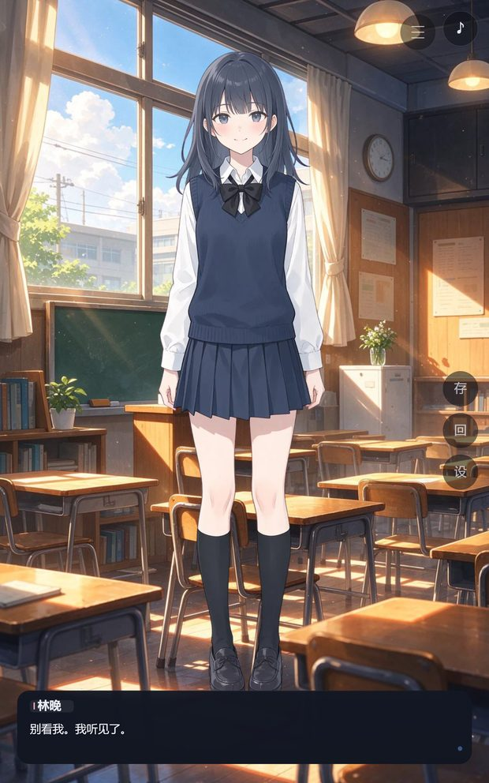

# MYONL 引擎

**简体中文** | [English](README.en.md)

[](https://github.com/123456789556/myonl/actions/workflows/tests.yml)


写几行中文脚本，做出一部能玩、能存档、能打包的视觉小说。

> **这是一个引擎工具（给创作者用），不是游戏作品**；仓库里的小样板只是可以随便改的起点。
> **玩家侧主线是手机 + 安卓平板**：同一个工程 → 竖屏横屏都能满屏跑的网页包 → 一个 APK 同时吃手机和平板；
> 桌面端是并行出口（编辑器和打包器在 Windows 上跑），不是唯一的出口。

## 先拿个能玩的

| 你要什么 | 拿哪个 | 多大 |
| :--- | :--- | :--- |
| 安卓手机 / 安卓平板直接装 | [**MYONL-apk-9.apk**](https://github.com/123456789556/myonl/releases/download/apk-9/MYONL-apk-9.apk) | 3.6 MB |
| 任何浏览器打开，不装东西 | 自己导出的单文件 HTML（`dist/web/研修日志.html`） | 约 3.0 MB |
| Windows 双击即玩（编辑器 + 打包器） | Release 页里的 Windows 免安装包 | 66.5 MB |

APK 的 `minSdk` 是 24（安卓 7.0），一个包同时装手机和安卓平板，横过来竖过去都在满屏范围内重排。
存档留在设备本机（`localStorage`），升级只换安装包、不动存档 —— 用的是固定签名，不会要求卸载重装。

## 一部真的作品：《研修日志》

引擎能不能做出东西，看这个而不是看说明：`games/研修日志/` 是一部 **12~15 分钟**的短篇 ——
5 章、281 句台词、一个分支、两个结局（要不要把十七张照片贴到那条快拆的街的卷帘门上）。
7 张真背景、5 张立绘、6 段音频全部随工程带，`missing []`。

- **手机上直接玩**：导出的单文件 HTML 传进手机，任何浏览器打开，竖屏横屏都满屏
- **改它**：编辑器打开 `games/研修日志/`，左栏点 `script.gal`，改一句就 `Ctrl+S`
- **它同时是回归样本**：`tests/test_p89_mobile_branch_and_game.py` 盯着「脚本能解析 / 两个结局 label 都在 /
  剧本引用的图一张不缺」—— 这个作品坏掉，测试先红

## 手机 / 平板优先

同一个工程，三条出口：**手机网页包**、**安卓 APK**（`android/` 自建 WebView 壳 + 固定签名，
`.github/workflows/android-apk.yml` 出 release 包）、**桌面目录**（双击即玩，目标机不装 Python）。

适配一台手机不难，"同一份代码同时喂手机和安卓平板"才是要钉的地方。三档设备下钉的是**物理尺寸**
而不是逻辑像素 —— 逻辑画布恒 1080 短边，但 1080 在 390 CSS 宽的手机上是 17 CSS px，在 800 CSS 宽的
平板上一放大就成了 35 CSS px，字翻倍、一屏只塞得下十几个字，那才是"平板像个放大版手机"的真身：

- **字号按物理反推**：目标 18.5 CSS px → 手机 51 / 平板 25 逻辑 px，落到眼睛里一样大；
- **正文一行 ≤39 字**：正文宽度上限 720 CSS px，管住平板横屏 1280×800、1024×600 那种宽画布；
- **立绘跟面板联动**：竖屏人取 `min(86% 屏高, 面板顶 - 6)`，一句短台词时人站大（平板竖屏到 71%），
  长句把面板顶高就连续收回去；横屏不夹（galgame 常态是人贴底、被对话框压住小腿）；
- 转屏手机 1080×2337 ↔ 2337×1080、安卓平板 1080×1728 ↔ 1728×1080 各跑一轮，scene / 背景 / 立绘连续，
  `panelH` 正确重算，`pageerror` 为空。

APK 壳有三条不能省（细节在 `docs/存档与升级.md`）：assets 必须挂到 `https://appassets.androidplatform.net`
（`file://` 下 localStorage 存不住档）、签名固定在一个 keystore 上（否则更新要求卸载、存档跟着删）、
返回键先交给 `window.myonlBack` 再退出。工程和签名入库，单文件 HTML 是 CI 产物不入库。

**手机上的编辑器是一个"应用"，不是一张塞进 390px 的 IDE**：

1. 打开先进「我的作品」——工程卡片（名字 / `49 条指令 · 21 个素材 · 11 天前`）+ 虚线「＋ 新建作品」，
   点开卡片才进编辑器，顶栏「‹ 作品」随时退回；
2. 编辑器只有 **一行顶栏**（作品 / 文件 / 全屏 / 更多）+ 正文 + 底部 **五个纯文字页签**
   （剧本 · 素材 · 外观 · 预览 · 导出）。菜单栏、活动栏、搜索框、面包屑、文件标签条、富文本工具条都不在手机上出现；
3. 正文按读书而不是按代码排：15px / 行高 28px / 行号槽 34px；状态栏只留「已保存」和「第 N 行」；
4. 设置是底部弹层（不是全屏弹窗）：深色 / 浅色、游戏画面方向（跟随 / 竖屏 / 横屏）、返回作品列表；
5. 横过来就换一套排法：顶栏同样一行，页签收窄到 46px，工作台卡片排两列，引导卡贴右边不被正文压住。

**不被锁死**：编辑器把同一个工程还能导成 **Ren'Py 工程**（`game/script.rpy` + 图片，解压丢进 Ren'Py SDK 即可跑）
或**通用 JSON**（`game.json` + `assets/`，任何引擎照表实现 op 即可读）。

> 编辑器 / 打包器：Windows 10 21H2+ / Windows 11 · Python 3.9+ · pygame-ce　·　玩家侧：安卓 7.0+ 或任何现代浏览器 · MIT · 完全离线

### 视频背景（`@video`）在手机上是省着放的

帧序列放在 `images/videos/名_001.png` 起连续编号（`@video 名 fps=24`）。桌面端随便缓存，
手机上不能：**一帧 1080×1920 解码后是 8 MB 出头，10 秒 24fps 就是 240 帧**，循环走完第一轮能吃 2 GB，
表现是"玩两分钟白屏"。所以播放器只保留**最近用过的 14 帧**（够覆盖半秒、够回头兜底），超出的丢掉引用交给 GC；
进 `@video` 先把头三帧叫醒（不然第一帧还在读，画面黑一下），`@bg` 切走立刻整片释放。

实测（24 帧序列循环）：手机 390×844 / 平板 800×1280 / 横屏两档，缓存恒定停在 14，切走后归 0，`pageerror` 为空。

### 最近四期

| 版本 | 做了什么 |
|---|---|
| P97 | 菜单、设置、存档、回顾从"卡片摞卡片"改成整幕：不再每页一层深色圆角大块，行只留分隔线 + 一条选中蓝条 |
| P98 | 说话的人亮、别人压到 0.72 亮度（只有说话人自己在场上才压别人，旁白不压）；存档格铺当时的背景缩略图；存档写不进去会明说，不再静默返回 |
| P99 | 安卓平板：字号按物理尺寸反推、正文限 720 CSS、立绘高度跟"当前"面板联动；测试契约从"逻辑字号"改成"物理字号 + 一行字数" |
| P100 | `@video` 帧池：只留最近 14 帧、进入预热、切走释放；存档格的台词按真实内宽收边（横屏三列原来会压到隔壁格子） |

## 界面

| 手机竖屏：标题 / 对话 | 手机竖屏：存档 / 菜单 |
|---|---|
|  |  |
|  |  |

| 手机横屏：存档 | 安卓平板：横屏 / 竖屏 |
|---|---|
|  |   |


## 三句话

- **写**：`script.gal` 是纯文本，24 条中文指令，任何编辑器都能改
- **看**：Web 编辑器左边写剧本、右边实时预览，改一行半秒内出画面
- **发**：一键出网页包或 APK，玩家装上就能玩，横竖屏都满屏

## 能做什么

**玩家侧**

- 标题 / 继续 / 读档 / 设置 / 画廊菜单，6 个档位 + 自动存档（带背景缩略图、台词、时间）
- 打字机对话、长段落自动分页、选项分支、历史回看
- 自动播放、快进（仅跳已读）、隐藏 UI 截图模式、全屏
- 存档导出 / 导入（`MYONL1:` 文本码），换设备不丢
- CG 与立绘画廊，按解锁进度展示

**创作侧**

- 24 条指令：`@bg` `@music` `@show` `@anim` `@fg` `@cg` `@camera` `@transition` `@chapter` `@choice` `@set` `@if` `@jump` `@voice` `@video` `@include` …
- 打字机、22 条缓动曲线、镜头 pan/zoom/shake、三种转场、帧序列视频背景、配音
- 语法检查、指令补全、素材拖拽导入、章节文件树、场景时间线、UI 设计面板
- 热重载：改 `.gal` 从当前场景重播，改 `config.json` 字号/颜色即时生效
- 逻辑画布可配（1280×720 / 1920×1080 等比缩放），素材按需加载 + LRU 缓存

## 剧本长什么样

```gal
@bg bg_天台
@music bgm_night

@label start
@show 林晚 微笑
@[林晚] 你又迟到了两分钟。      # 方括号 = 角色台词（不登记也能用）
@ 晚风把她的发梢吹起。          # @ + 空格 = 旁白
@choice:
  > 一起看日落 -> 结局_看日落
  > 说出那个约定 -> 结局_约定

@label 结局_看日落
@[[林晚]] 那年夏天，风很长。    # 双括号 = 整屏独白（NVL）
@end
```

存档记的是「离哪个标签往后数几句」，不是行号，所以剧本小改、加新章节，旧存档依然能读。

## 它是怎么跑起来的


同一套 `parser → runtime → 素材清单` 既供玩家窗口，也供编辑器右侧预览和网页包：预览就是引擎的真实渲染，不是另画的示意图。

## 源码开发（Windows，需 Python 3.9+）

```powershell
pip install -r requirements.txt

# 1) 跑自带示例（三幕小故事：走廊 → 天台 → 教室）
py -3 -m engine.demo games/标准示例/script.gal --assets games/标准示例

# 2) 新建一个自己的游戏（默认教学骨架；编辑器里新建则是极简 hello world）
py -3 -m engine.cli new 我的第一个游戏

# 3) 打开 Web 编辑器（浏览器 http://127.0.0.1:8000）
py -3 -m engine.editor --project games/我的第一个游戏

# 4) 打包成玩家双击即玩的目录（dist/<游戏名>/）
py -3 pack.py games/我的第一个游戏

# 5) 出单文件网页包（手机/平板用这个）
py -3 -c "from engine.webpack import build_single; build_single(r'games\我的第一个游戏', r'dist\web\游戏.html', title='游戏')"
```

写剧本时建议开热重载：

```powershell
py -3 -m engine.demo games/我的第一个游戏/script.gal --assets games/我的第一个游戏 --hot-reload
```

改 `.gal` → 500ms 内从当前场景重播；改 `config.json` → 字号/颜色/对话框即时生效。

### 测试与门禁

```powershell
py -3 -m pytest -q -m "not slow"      # 日常快跑（约 70s）
py -3 -m pytest -q                    # 全量 1168 passed + 1 skipped（含 slow，耗时较长）
py -3 -m pytest -q -m slow            # 真实打包 / 全渲染 / 性能用例
```

- 测试分层：`unit` / `ui` / `integration` / `slow`；覆盖率门禁 80%（`tools/check_coverage.ps1`）
- 类型检查棘轮：`tools/check_types.ps1`（只拦新增，不偿还存量）
- 交互走查：`py -3 tools/ui_walkthrough.py --game games/标准示例`（真实键鼠事件驱动，逐屏截图并断言）
- 布局契约：`web/test/layout-smoke.js` 盯「物理字号 17.5~19.5 CSS」「一行 ≤41 字」，覆盖手机竖横、
  安卓平板竖横、1024×600 五档 —— 改字号或面板宽度会先在这里红

> 免安装发行包（`editor.exe` + 内置运行库）不放进 Git，用 `build_editor.bat` 与 `tools/build_release_zip.py` 可复现构建。

## 目录

| 目录 | 内容 |
|---|---|
| `engine/` | 引擎核心：解析、运行时、渲染（10 个 render 模块）、存档、编辑器后端、网页包/打包 |
| `web/` | 手机 / 平板播放器（`myonl-player.js`、`myonl-layout.js`）与布局契约测试 |
| `android/` | APK 工程（WebView 壳 + 固定签名 + Gradle 配置） |
| `editor/` | Web 编辑器前端（HTML/CSS/JS，无构建） |
| `games/` | 示例工程（研修日志 / 标准示例 / 教程示例 / 新游戏模板） |
| `tests/` | pytest 无头测试套件（unit / ui / integration / slow） |
| `tools/` | 门禁与工具脚本（coverage / pyright / 打包验证 / 素材导入等） |
| `docs/` | 上手 / 产品说明 / 引擎规格 / 存档与升级 / 开发者与打包指南 |

## 文档

- 快速上手：[docs/快速上手.md](docs/快速上手.md)
- 产品说明：[docs/产品说明书.md](docs/产品说明书.md)
- 引擎规格（指令全集）：[docs/engine_spec.md](docs/engine_spec.md)
- 存档与升级（为什么升级不毁档）：[docs/存档与升级.md](docs/存档与升级.md)
- 开发者指南：[docs/开发者使用指南.md](docs/开发者使用指南.md)
- 打包指南：[docs/打包使用指南.md](docs/打包使用指南.md)
- 素材导入指南：[docs/素材导入指南.md](docs/素材导入指南.md)
- 变更记录：[docs/CHANGELOG.md](docs/CHANGELOG.md) · 当前状态：[docs/STATUS.md](docs/STATUS.md)

## 常见问题

- **要会编程吗？** 不用。剧本就是 24 条中文指令；只有当你想改引擎本身时才需要读 Python。
- **要联网吗？** 不用。写、预览、打包、游玩全程离线，APK 也不联网。
- **支持 Mac / Linux 吗？** 编辑器与打包器这版只在 Windows 跑（pygame / PyInstaller）；**玩家侧不限** ——
  网页包任何现代浏览器都能开，APK 是安卓 7.0 以上。拿 Mac 写剧本、用手机出包这条路没做。
- **平板要单独打包吗？** 不用。一个 APK 同时装手机和安卓平板，横竖屏按屏幕重排；素材也只有一份。
- **能做 3D / 联机吗？** 不做。这版只做视觉小说，并明确拒绝通用引擎方向。
- **改剧本会让旧存档失效吗？** 不会。存档锚点是「标签 + 偏移」，不是行号。
- **升级会不会冲掉存档？** 不会。APK 用固定签名，覆盖安装；存档在应用自己的存储里，导出/导入也留了后路。
- **打包出来多大？** 桌面版运行库约 46 MB；单文件网页包约 3 MB（素材全内联）；APK 约 3.8 MB。
- **内置 AI 吗？** 没有。引擎对外提供 JSON 控制原语，可被外部脚本 / AI 调用，但产品本身不含模型。
- **示例素材能商用吗？** 先读 `NOTICE`；第三方素材各自有条款，不要直接搬。

## English

MYONL is an **offline, MIT-licensed visual-novel (galgame) engine and authoring tool**. You write a
plain-text `.gal` script using 24 Chinese commands; the engine handles parsing, presentation
(typewriter, camera, transitions, animated sprites, frame-sequence video backgrounds, voice),
branching, save/load, a CG gallery, and packaging.

**Player side targets phones and Android tablets**: one project exports to a single-file HTML bundle
that fills the screen in both orientations, or to an Android APK (minSdk 24) built by GitHub Actions.
A Windows desktop build (double-click, no Python on the player's machine) ships in parallel.
Typography is pinned to physical CSS size, not logical pixels, so text stays the same size on a
390 px phone and an 800 px tablet; body text is capped at 720 CSS px (~39 chars per line).

- Editor / packager from source: Python 3.9+ + `pygame-ce>=2.5` (Windows only).
- Tests: `pytest -q` → 1168 passed + 1 skipped headless cases.
- Documentation is written in Chinese: [快速上手](docs/快速上手.md) · [engine spec](docs/engine_spec.md).

## 许可

MIT（见 [LICENSE](LICENSE)）。第三方组件与素材许可见 [NOTICE](NOTICE)。

> 本产品完全离线运行，不依赖任何在线服务。
