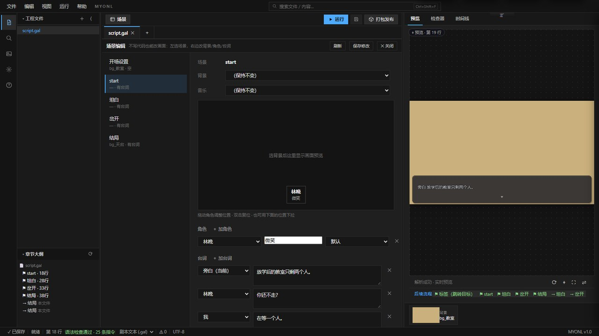
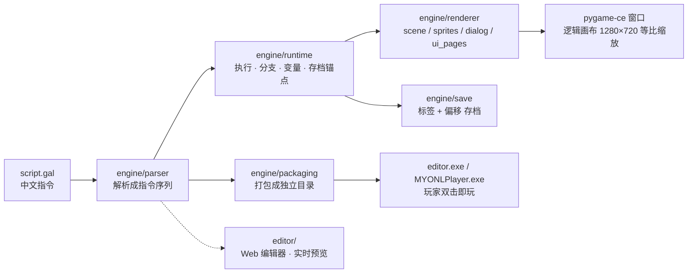

# MYONL 引擎

[](https://github.com/123456789556/myonl/actions/workflows/tests.yml)


写几行中文脚本，做出一部能玩、能存档、能打包的视觉小说。

> **这是一个引擎工具（给创作者用），不是游戏作品**；仓库里的小样板只是可以随便改的起点。
> Windows 10 21H2+ / Windows 11 · Python 3.9+ · pygame-ce · MIT · 完全离线


## 三句话

- **写**：`script.gal` 是纯文本，24 条中文指令，任何编辑器都能改
- **看**：Web 编辑器左边写剧本、右边实时预览，改一行半秒内出画面
- **发**：一键打包成玩家双击即玩的目录，目标机器不装 Python、不做配置

## 能做什么

**玩家侧**

- 标题 / 继续 / 读档 / 设置 / 画廊菜单，10 个存档位 + 快速存档（带缩略图与章节名）
- 打字机对话、长段落自动分页、选项分支、历史回看
- 自动播放、快进（仅跳已读）、隐藏 UI 截图模式、全屏
- CG 与立绘画廊，按解锁进度展示

**创作侧**

- 24 条指令：`@bg` `@music` `@show` `@anim` `@fg` `@cg` `@camera` `@transition` `@chapter` `@choice` `@set` `@if` `@jump` `@voice` `@video` `@include` …
- 打字机、22 条缓动曲线、镜头 pan/zoom/shake、三种转场、帧序列视频背景、配音
- 语法检查、指令补全、素材拖拽导入、章节文件树、场景时间线、UI 设计面板
- 热重载：改 `.gal` 从当前场景重播，改 `config.json` 字号/颜色即时生效
- 逻辑画布可配（1280×720 / 1920×1080 等比缩放），素材按需加载 + LRU 缓存

## 界面

| | |
|---|---|
|  标题：继续项按有无存档自动灰置 |  存档：10 位 + 缩略图 + 章节名 |
|  画廊：CG / 立绘双页签 |  编辑器：场景编辑 + 实时预览 |

## 剧本长什么样

```gal
@bg bg_天台
@music bgm_night

@label start
@show 林晚 微笑
@[林晚] 你又迟到了两分钟。      # 方括号 = 角色台词（不登记也能用）
@ 晚风把她的发梢吹起。          # @ + 空格 = 旁白
@choice:
  > 一起看日落 -> 结局_看日落
  > 说出那个约定 -> 结局_约定

@label 结局_看日落
@[[林晚]] 那年夏天，风很长。    # 双括号 = 整屏独白（NVL）
@end
```

存档记的是「离哪个标签往后数几句」，不是行号，所以剧本小改、加新章节，旧存档依然能读。

## 它是怎么跑起来的



同一套 `parser → runtime → renderer` 既供玩家窗口，也供编辑器右侧预览：预览就是引擎的真实渲染，不是另画的示意图。

## 源码开发（Windows，需 Python 3.9+）

```powershell
pip install -r requirements.txt

# 1) 跑自带示例（三幕小故事：走廊 → 天台 → 房间）
py -3 -m engine.demo games/标准示例/script.gal --assets games/标准示例

# 2) 新建一个自己的游戏（默认教学骨架；编辑器里新建则是极简 hello world）
py -3 -m engine.cli new 我的第一个游戏

# 3) 打开 Web 编辑器（浏览器 http://127.0.0.1:8000）
py -3 -m engine.editor --project games/我的第一个游戏

# 4) 打包成玩家双击即玩的目录（dist/<游戏名>/）
py -3 pack.py games/我的第一个游戏
```

写剧本时建议开热重载：

```powershell
py -3 -m engine.demo games/我的第一个游戏/script.gal --assets games/我的第一个游戏 --hot-reload
```

改 `.gal` → 500ms 内从当前场景重播；改 `config.json` → 字号/颜色/对话框即时生效。

### 测试与门禁

```powershell
py -3 -m pytest -q                    # 全量 1021 项（含 slow，耗时较长）
py -3 -m pytest -q -m "not slow"      # 日常快跑 988 通过 + 1 跳过（约 67s）
py -3 -m pytest -q -m slow            # 真实打包 / 全渲染 / 性能用例
```

- 测试分层：`unit` / `ui` / `integration` / `slow`；覆盖率门禁 80%（`tools/check_coverage.ps1`）
- 类型检查棘轮：`tools/check_types.ps1`（只拦新增，不偿还存量）
- 交互走查：`py -3 tools/ui_walkthrough.py --game games/标准示例`（真实键鼠事件驱动，逐屏截图并断言）

> 免安装发行包（`editor.exe` + 内置运行库）不放进 Git，用 `build_editor.bat` 与 `tools/build_release_zip.py` 可复现构建。

## 目录

| 目录 | 内容 |
|---|---|
| `engine/` | 引擎核心：解析、运行时、渲染（10 个 render 模块）、存档、编辑器后端、打包 |
| `editor/` | Web 编辑器前端（HTML/CSS/JS，无构建） |
| `games/` | 示例工程（标准示例 / 教程示例 / 新游戏 / 新游戏模板） |
| `tests/` | pytest 无头测试套件（unit / ui / integration / slow） |
| `tools/` | 门禁与工具脚本（coverage / pyright / 打包验证 / 素材导入等） |
| `docs/` | 上手 / 产品说明 / 引擎规格 / 开发者与打包指南 / 贡献说明 |

## 文档

- 快速上手：[docs/快速上手.md](docs/快速上手.md)
- 产品说明：[docs/产品说明书.md](docs/产品说明书.md)
- 引擎规格（指令全集）：[docs/engine_spec.md](docs/engine_spec.md)
- 开发者指南：[docs/开发者使用指南.md](docs/开发者使用指南.md)
- 打包指南：[docs/打包使用指南.md](docs/打包使用指南.md)
- 素材导入指南：[docs/素材导入指南.md](docs/素材导入指南.md)
- 贡献说明：[docs/贡献指南.md](docs/贡献指南.md)

## 常见问题

- **要会编程吗？** 不用。剧本就是 24 条中文指令；只有当你想改引擎本身时才需要读 Python。
- **要联网吗？** 不用。写、预览、打包、游玩全程离线。
- **支持 Mac / Linux 吗？** 本期只支持 Windows（10 21H2+ / 11）；跨平台放在 BACKLOG 里，没有排期。
- **能做 3D / 联机 / 手游吗？** 不做。这版只做视觉小说，并明确拒绝通用引擎方向。
- **改剧本会让旧存档失效吗？** 不会。存档锚点是「标签 + 偏移」，不是行号。
- **打包出来多大？** 运行库约 46MB，随游戏一起分发；玩家机器不需要 Python。
- **内置 AI 吗？** 没有。引擎对外提供 JSON 控制原语，可被外部脚本 / AI 调用，但产品本身不含模型。
- **示例素材能商用吗？** 先读 `NOTICE`；第三方素材各自有条款，不要直接搬。

## English

MYONL is an **offline, MIT-licensed visual-novel (galgame) engine and authoring tool for Windows**. You write a plain-text `.gal` script using 24 Chinese commands; the engine handles parsing, presentation (typewriter, camera, transitions, animated sprites, video backgrounds, voice), branching, save/load, a CG gallery, and one-click packaging into a double-click-able build that needs no Python on the player's machine. A built-in web editor with real-render preview ships with it.

- From source: Python 3.9+ + `pygame-ce>=2.5` (Windows only).
- Tests: `pytest -q -m "not slow"` → 988 passed + 1 skipped headless cases.
- Documentation is written in Chinese: [快速上手](docs/快速上手.md) · [engine spec](docs/engine_spec.md).

## 许可

MIT（见 [LICENSE](LICENSE)）。第三方组件与素材许可见 [NOTICE](NOTICE)。

> 本产品完全离线运行，不依赖任何在线服务。
