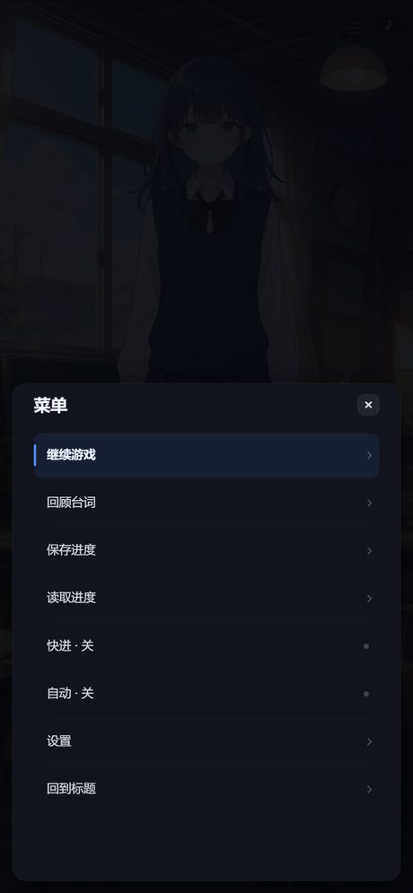
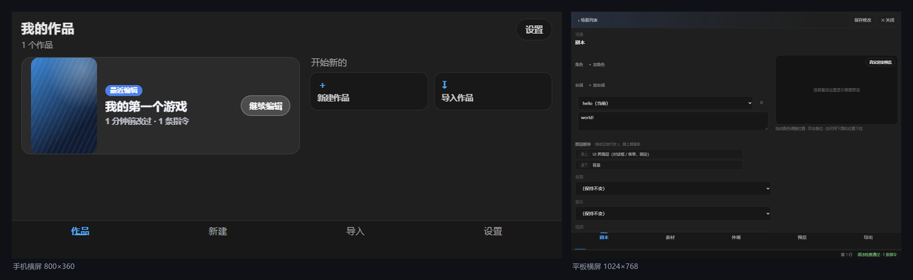
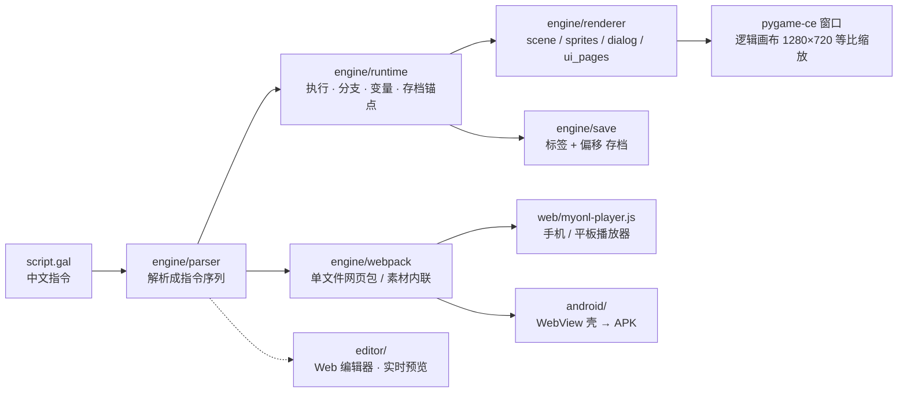

# MYONL · 手机游戏制作器

**简体中文** | [English](README.en.md)

[](https://github.com/123456789556/myonl/actions/workflows/tests.yml)


**装在安卓手机上，就能自己做视觉小说。** 写台词、放图、放音乐，点一下导出，
出来的文件发给谁都能打开玩。

## 手机是主场，电脑是助手

**一句话：日常创作 100% 在手机上完成，电脑只在"要发版"的时候才需要出现。**

手机不是"简易版"，它就是主版本。你在手机上写的东西，和电脑上写的是同一份东西——
同一套 `script.gal`、同一套 `@bg/@choice/@jump`、同一个导出成品。

### 手机能干的事（全部）

- 新建 / 删除作品，改名字
- 写场景、改台词、改名（连带改所有跳转和选项指向）
- 从相册导入图、从相机拍一张直接用
- 挑背景、摆立绘、调图层顺序
- 按 16:9 / 20:9 / 4:3 比例预览真实画面
- 看正文总字数
- 导出成品 `.html`，直接发微信或 QQ
- 切换深浅主题、换主题色

### 电脑端也是完整编辑器

先说清楚一件事：**电脑端能编辑，而且编辑的是同一套界面。**

不是"电脑只能打包"——`python -m engine.editor` 启动后，浏览器打开就是完整编辑器，
和手机上是同一套界面、同一套语法、同一份 `script.gal`。功能是**重复**的，不是互补的。

想让电脑端不依赖命令行，打包成双击就能开的窗口程序：

```
build_editor.bat
```

一条命令，产出 `dist/editor/editor.exe`（约 17 MB，借系统自带 WebView2，不带浏览器内核）。
双击就是编辑器窗口，不用先装 Python、不用记参数。

**打包作品也是一样低的负担**：编辑器里打开「打包发布」，点「一键打包」——
作品名当游戏名、版本号自动 +1、运营号用默认值，下面那 8 个字段（图标 / 渠道 / 发行说明……）
是给真要发行的人准备的，平时不用碰。

> 踩过的坑：这台机器上 PyInstaller 6.22.3 + pywebview 6.2.1 都是现成的，
> 单文件实测 17.15 MB。走 Electron 的话同样功能要 60–100 MB——差的就是那一整套 Chromium 内核。

电脑端多出来的，只有下面这几件，全是**发版工具**，不是创作工具：

- 从网址导入素材（手机受跨站限制，做不到，会明说）
- 打包 exe
- **把作品打成 APK**（这条手机暂时做不了，原因写在下面）
- 跑 1393 条测试
- 批量整理几十个素材文件

**创作这件事，两边一模一样；主要受众是手机端。** 电脑只是"要发版、要批量整理时才打开的那台机器"。

### 把作品打成 APK

菜单「文件 → 打成 APK」，或者命令行：

```
python tools/pack_apk.py --game dist/single/你的作品.html
```

出来是 `dist/apk/你的作品.apk`，约 2.2 MB，传到手机上点开就能装。

**它怎么做到的**：模板 APK（`android/template.apk`，1.6 MB 的壳）里，
作品本体就是 `assets/game.html` 这**一个文件**。打包 = 把这一个文件换掉，
再按同一张证书重签 v2。不碰 dex、不碰 manifest、不需要 Android 构建链。

**需要 Java 一次**：重签走官方 apksig 库（`tools/vendor/uber-apk-signer.jar`），
所以要一个 JRE 17+。没装的话，编辑器会直接告诉你装什么、去哪下，不会让你猜。

**手机端为什么还打不了**：手机里跑的是 WebView，没有 Java 层去调 RSA 签名。
要做就得在 Android 壳里加一个签名模块、重新编译——那是另一件事，还没做。
现在手机上导出的仍然是单个 `.html`，发微信就能玩；要装成 App 就得走一次电脑。

> 证书在 `android/keystore/myonl-test.p12`，**不入库**（公开仓库里放私钥 + 密码，
> 等于谁都能签个同名同签名的包去覆盖安装）。自己 clone 下来用，要把这张证书准备好；
> CI 那边从 repository secret 还原。

### 一套界面，两种跑法

| | 手机 | 电脑 |
|---|---|---|
| 界面 | 同一套 HTML / JS | 同一套 |
| 后端 | `editor/gal_offline.js` 把 `/api/*` 就地接住，素材进 IndexedDB | `engine/` 的 Python 后端，素材落磁盘 |
| 谁在用 | 写东西的人 | 打包、跑测试、批量整理的人 |
| 能不能互相顶替 | 顶不了：手机上装不了 Python | 顶不了：电脑能模拟尺寸，模拟不了真机的存储配额和手感 |

这不是技术选型，是产品定位：**手机上每一步都得自足**。做不到的（网址导入、打包 APK）
就明说不做到，绝不留一条"你回电脑上补一下"的暗门。

> **现在还很粗糙。** 界面单调、交互不顺手、不少地方是边用边改的，目前只有作者自己在用。
> 这不是成品，是一个还在长的东西 —— 介意的话先别装。

| 手机上玩成品 | 游戏菜单 |
|:---:|:---:|
|  |  |

## 长什么样

四种竖屏尺寸（360×800 / 390×844 / 412×915 / 360×640）：同一套界面在每种屏上都在底部
留四个入口，正文给导航让位。只对尺寸负责，不对哪个牌子负责。


横屏（800×360 / 1024×768）：导航留在底部，不搬去侧边。



深色与浅色（设置里随时切）：


预览框可以按比例看（16:9 / 20:9 / 4:3），做的时候知道自己的画面在真机上什么处境。

## 装它

**[⬇ 下载 MYONL-v1.2.0.apk](https://github.com/123456789556/myonl/releases/download/v1.2.0/MYONL-v1.2.0.apk)** · 安卓 7.0 以上 · 手机平板同一个包

装好打开就是书架，点「新建作品」开始。点底部「导出」得到一个自包含 `.html`，
发微信、发 QQ、传电脑，对方浏览器打开就能玩。

## 三步出东西

1. **写** —— 点作品进去，中间那栏写台词，一行一句。`@` 开头的是指令（`@bg 教室` 换背景、`@music 名字` 放歌）。
2. **放素材** —— 底部「素材」，把图 / 音乐选进素材库；手机上点一下就能选，也能从相册「分享」进来。
3. **导出** —— 底部「导出」，得到一个 `.html`，发给谁都能打开玩。

## 关于你的数据

- **东西都在这台设备里** —— 作品和素材不上传、不联网。省心的另一面是限制：换手机得自己导出带走。
- **换新版不用重装数据** —— 固定签名，覆盖安装不清空作品。
- **横屏竖屏都能用，但还没调好** —— 横过来能用，布局粗糙，正在改。

## 版本怎么算

装最新那个就行，**存档不会丢**，不用比版本号。

| 号 | 什么时候动 |
|---|---|
| `v1.0.0` → `v1.1.0` | 多出一件你能做的事 |
| `v1.1.0` → `v1.1.1` | 修掉影响使用的问题，或界面明显变了 |
| 不动号 | 重构、补测试、像素微调 —— 只提交，攒着跟下次一起发 |

每次发版都在 [docs/CHANGELOG.md](docs/CHANGELOG.md) 写清楚「你能感觉到什么变了」，
不写内部流水账。细则见 [docs/版本规则.md](docs/版本规则.md)。

---

# 给想深究的人

只想做游戏的话，上面那些就够了。下面是技术细节。

> 全量测试当前 **1393 passed, 3 skipped、退出码 0**（2026-11-19 本机已复跑；数随版本变，以最新一次 `pytest -q` 为准）。

## 手机端能做什么、做不到什么

**能编、能存、能放图放音乐、能自己出成品。**

- 剧本由 `engine/parser.js` 解析，和电脑端 `engine/parser.py` **逐字段一致**（`tools/pack_diff.py`
  拿 `games/` 下工程对拍）；成品由 `engine/pack.js` 拼成单文件 HTML，手机上点一下就能导出。
- **素材**：图片进来就压到最长边 1280；音频原样存；存在设备本机（图片在 `IndexedDB`，剧本在 `localStorage`）。
- **一个真实上限**：单文件 HTML 把素材内联成 base64（体积再涨约三分之一），40 MB 起软提醒、
  80 MB 做强提示（不硬拦导出），但超 80 MB 低端机大概率白屏。更大的素材要走「文件夹 / zip 发行」，还没做。

APK 的 `minSdk` 是 24（安卓 7.0），一个包同时装手机和安卓平板。
**APK 里装的是编辑器**：打开就是「我的作品」，能新建、能写剧本、能放素材、能存本机、能把成品导出带走。

手机端解析器未实现 `@voice` `@anim` `@fg` `@cg` `@camera` `@transition` `@plug` `@include`，
写到这些行会明确报错并指出第几行；完整边界见 [docs/手机端编游戏.md](docs/手机端编游戏.md)。

## 其它拿法

| 你要什么 | 拿哪个 |
| :--- | :--- |
| 任何浏览器打开，不装东西 | 自己导出的单文件 HTML（编辑器底部「导出」一点就有） |
| 编辑器单文件（`file://` 双击就能编，带离线内核） | `py -3 tools/build_editor_single.py` → `dist/web/editor-single.html` |
| **发行包**（Windows 双击即玩，玩家的机器上不用装 Python） | 仓库内 `py -3 tools/build_release_zip.py` 自建；包里只放成品和使用说明，不带源码指令 |

> 不做 iOS。网页包在 iOS 浏览器里能打开，但没有 iOS 安装包。

## 示例工程（都是自己造的，不是别人的作品）

`games/` 里四个，打开就能改：

- **教程示例**（14 个文件）—— 指令怎么用，一句一句都标好了
- **标准示例**（24 个文件）—— 一个完整工程长什么样：剧本、素材、配置齐全
- **新游戏模板**（21 个文件）—— 从空的开始，删干净只剩骨架
- **newbie_demo**（7 个文件）—— 内置进 APK 的试玩示例

素材全是自己造的占位图，随便改、随便删，不用惦记版权。
拿别人的游戏当样板属于再分发，不进这个仓库。

## 剧本长什么样

```gal
@bg bg_天台
@music bgm_night

@label start
@show 林晚 微笑
@[林晚] 你又迟到了两分钟。      # 方括号 = 角色台词（不登记也能用）
@ 晚风把她的发梢吹起。          # @ + 空格 = 旁白
@choice:
  > 一起看日落 -> 结局_看日落
  > 说出那个约定 -> 结局_约定

@label 结局_看日落
@[[林晚]] 那年夏天，风很长。    # 双括号 = 整屏独白（NVL）
@end
```

存档记的是「离哪个标签往后数几句」，不是行号，所以剧本小改、加新章节，旧存档依然能读。
指令全集与参数见 [docs/engine_spec.md](docs/engine_spec.md)。

## 它是怎么跑起来的



同一套 `parser → runtime → 素材清单` 既供玩家窗口，也供编辑器右侧预览和网页包：预览就是引擎的真实渲染，不是另画的示意图。

## 代码结构：一套界面，两套后端

| 在哪跑 | 靠什么 | 体量 |
|---|---|---|
| 电脑（Windows / 浏览器） | 网页界面 + Python 后端 `engine/` | 42 个 py，806 KB，需要 Python 3.9+ |
| 手机（APK） | 同一套界面 + `editor/gal_offline.js` | 70 KB，不需要 Python |

手机上装不了 Python，所以 APK 里没有解释器：`gal_offline.js` 把编辑器发出去的 `/api/*` 请求就地接住并自己实现。

**代价（说明白）**：`@bg` / `@choice` / `@jump` 这套规则现在存在两份实现——Python 一份、JS 一份。电脑上改了规则，手机上得手动跟一遍，否则**手机上看到的预览和导出的成品可能跟电脑不一致**。这是当前最大的结构风险，不是小问题。

**为什么不直接统一**：Python 那份有 1393 条测试兜着，JS 这份没有同等密度的测试。直接砍掉 Python 等于把护栏一起砍了。真要收敛成一份，得先把等价的 JS 测试建起来再动。

**体积与内存（实测，不是估计）**
- APK 2.21 MB，其中 `classes.dex`（WebView 壳）占 66%，`lib/` 下 0 个 .so
- 编辑器单文件 777 KB；前端 13 个 JS 合计 537 KB
- 打包器带内存预算门禁：素材体积超阈值会提示，位图缓存上限 160 MB


## 源码开发（Windows，需 Python 3.9+）

```powershell
pip install -r requirements.txt

# 1) 跑自带示例
py -3 -m engine.demo games/标准示例/script.gal --assets games/标准示例

# 2) 新建一个自己的游戏
py -3 -m engine.cli new 我的第一个游戏

# 3) 打开 Web 编辑器（浏览器 http://127.0.0.1:8000）
py -3 -m engine.editor --project games/我的第一个游戏

# 4) 打包成玩家双击即玩的目录（dist/<游戏名>/）
py -3 pack.py games/我的第一个游戏

# 5) 出单文件网页包（手机/平板用这个）
py -3 -c "from engine.webpack import build_single; build_single(r'games\我的第一个游戏', r'dist\web\游戏.html', title='游戏')"
```

### 测试与门禁

```powershell
py -3 -m pytest -q -m "not slow"      # 日常快跑
py -3 -m pytest -q                    # 全量（含 slow；通过数以最新 CHANGELOG 为准）
py -3 -m pytest -q -m slow            # 真实打包 / 全渲染 / 性能用例
```

- 测试分层：`unit` / `ui` / `integration` / `slow`；覆盖率门禁 80%（`tools/check_coverage.ps1`）
- 类型检查棘轮：`tools/check_types.ps1`（只拦新增，不偿还存量）
- 改代码的环境、门禁与提交约定见 [docs/贡献指南.md](docs/贡献指南.md)；模块结构见 [docs/架构说明.md](docs/架构说明.md)

## 目录

| 目录 | 内容 |
|---|---|
| `engine/` | 引擎核心：解析、运行时、渲染、存档、编辑器后端、网页包/打包 |
| `web/` | 手机 / 平板播放器与布局契约测试 |
| `android/` | APK 工程（WebView 壳 + 固定签名 + Gradle 配置） |
| `editor/` | Web 编辑器前端（HTML/CSS/JS，无构建） |
| `games/` | 示例工程（全是自造素材） |
| `tests/` | pytest 无头测试套件（unit / ui / integration / slow） |
| `tools/` | 门禁与工具脚本（coverage / pyright / 打包验证 / 素材导入等） |
| `docs/` | 上手 / 产品说明 / 引擎规格 / 存档与升级 / 开发者与打包指南 |

## 文档

- [快速上手](docs/快速上手.md) · [手机端编游戏](docs/手机端编游戏.md)
- [引擎规格（指令全集）](docs/engine_spec.md) · [素材导入指南](docs/素材导入指南.md)
- [打包使用指南](docs/打包使用指南.md) · [存档与升级](docs/存档与升级.md)
- [架构说明](docs/架构说明.md) · [贡献指南](docs/贡献指南.md) · [插件开发指南](docs/插件开发指南.md)
- [产品说明书](docs/产品说明书.md) · [版本规则](docs/版本规则.md) · [变更记录](docs/CHANGELOG.md)

## 常见问题

- **要会编程吗？** 不用。剧本是有限几条中文指令；只有当你想改引擎本身时才需要读 Python。
- **要联网吗？** 不用。写、预览、打包、游玩全程离线，APK 也不联网。
- **支持 Mac / Linux 吗？** 编辑器与打包器这版只在 Windows 跑；**玩家侧不限** —— 网页包任何现代浏览器都能开，APK 是安卓 7.0 以上。
- **平板要单独打包吗？** 不用。一个 APK 同时装手机和安卓平板，横竖屏按屏幕重排；素材也只有一份。
- **能做 3D / 联机吗？** 不做。这版只做视觉小说。
- **改剧本会让旧存档失效吗？** 不会。存档锚点是「标签 + 偏移」，不是行号。
- **升级会不会冲掉存档？** 不会。APK 用固定签名，覆盖安装；存档在应用自己的存储里，导出/导入也留了后路。
- **打包出来多大？** APK 是壳 + 播放器；单文件网页包**看素材**——素材全内联进 base64 会再涨约三分之一，素材越多越大，这是这条路线的真实上限，不是 bug。
- **内置 AI 吗？** 没有。引擎对外提供 JSON 控制原语，可被外部脚本 / AI 调用，但产品本身不含模型。
- **示例素材能商用吗？** 先读 `NOTICE`；第三方素材各自有条款，不要直接搬。

## English

MYONL is an **offline, MIT-licensed visual-novel (galgame) engine and authoring tool**. You write a
plain-text `.gal` script; the engine handles parsing, presentation (typewriter, camera, transitions,
animated sprites, video backgrounds, voice), branching, save/load, a CG gallery, and packaging.

**Player side targets phones and Android tablets**: one project exports to a single-file HTML bundle
that fills the screen in both orientations, or to an Android APK (minSdk 24) built by GitHub Actions.
A Windows desktop build (double-click, no Python on the player's machine) ships in parallel.

- Editor / packager from source: Python 3.9+ + `pygame-ce` (Windows only).
- Tests: `pytest -q` → full suite headless, all green (exact count in the latest CHANGELOG).
- Documentation is written in Chinese: [快速上手](docs/快速上手.md) · [engine spec](docs/engine_spec.md).

## 许可

MIT（见 [LICENSE](LICENSE)）。第三方组件与素材许可见 [NOTICE](NOTICE)。

> 本产品完全离线运行，不依赖任何在线服务。
