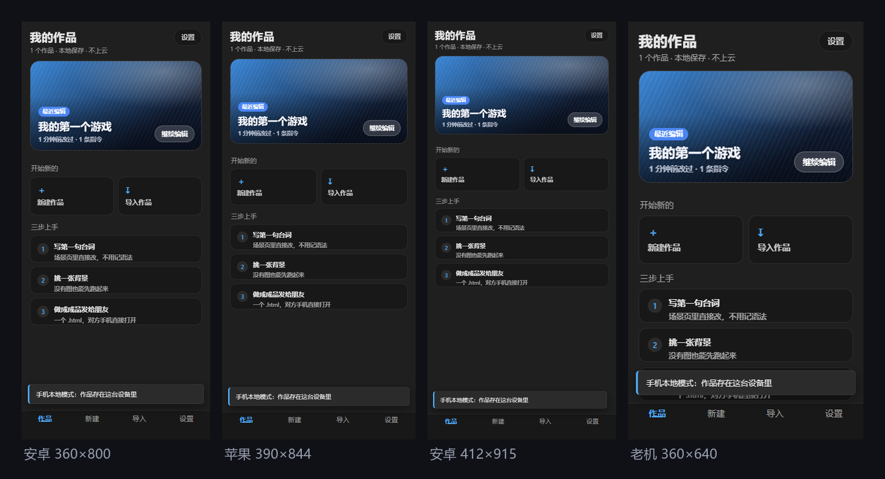
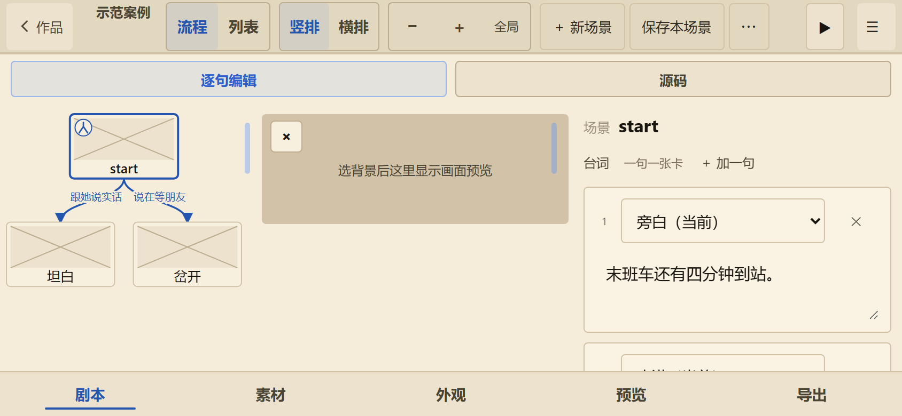
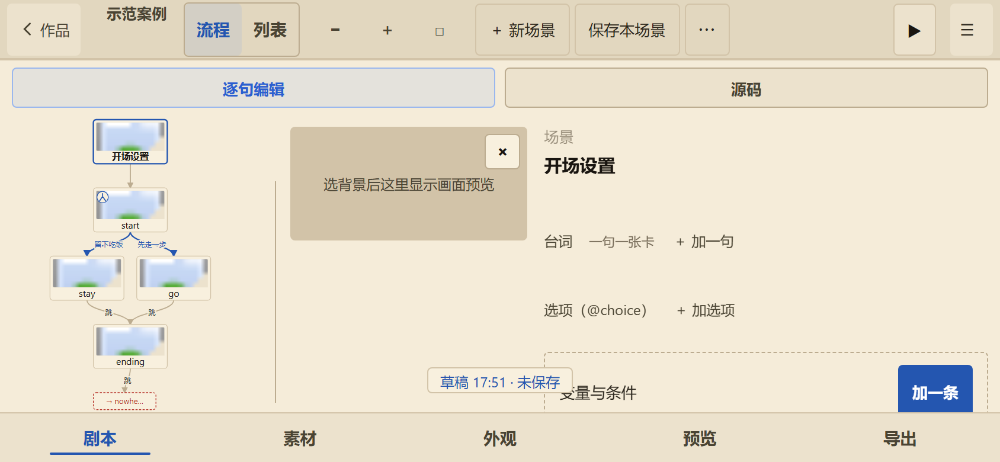
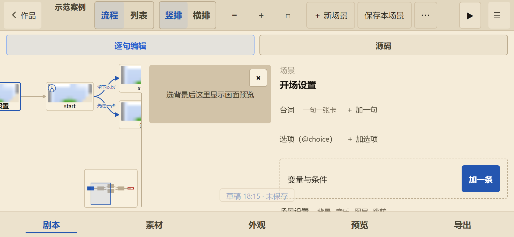
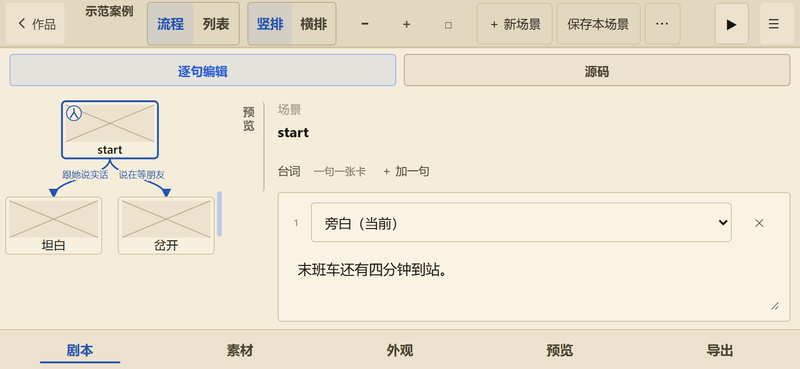
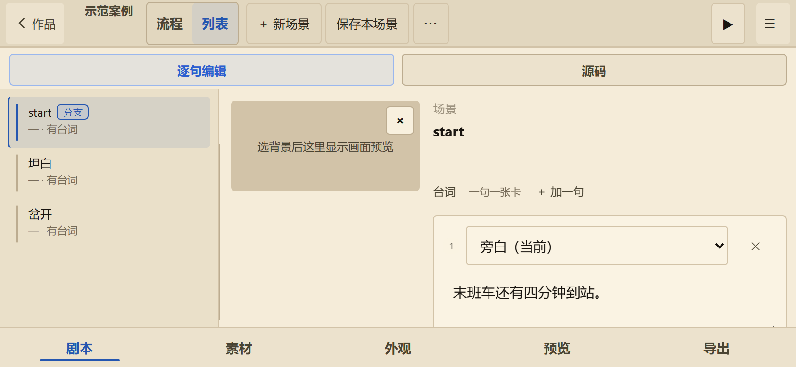
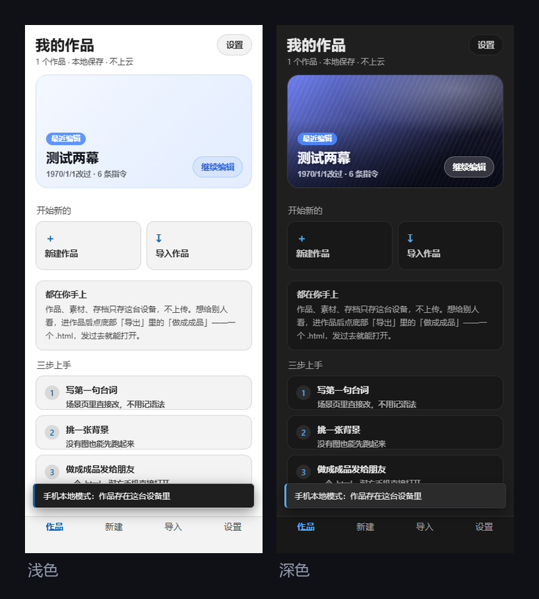
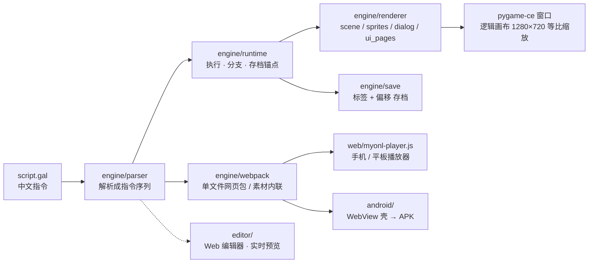

# MYONL · 手机上的视觉小说编辑器

[](https://github.com/123456789556/myonl/actions/workflows/tests.yml)


写台词、放图、放音乐，导出成一个文件，发给谁都能打开看。

一个开源项目，免费，离线可用，没有账号也没有服务器。

## 下载（两端同一个版本号，一起发）

每个 [Release](https://github.com/123456789556/myonl/releases/latest) 里挂着两个包，版本号一致：

| 包 | 装在哪 | 怎么用 |
|---|---|---|
| `MYONL-vX.Y.Z.apk` | 安卓 7.0+ 手机 / 平板 | 装上就是编辑器，不用电脑 |
| `MYONL-vX.Y.Z-editor-win.zip` | Windows 10/11 | 解压后双击 `editor.exe`，不用装 Python |

- 手机做的作品导出成 **`.myonl`**（剧本 + 它用到的素材，一个文件），电脑端能直接导入接着改；反过来也行。
- 版本号只有一个来源（`engine/_version.py`），CI 会校验 git tag 与它一致，**不一致就发不出去** —— 所以不会再出现「APK 是 1.2.x、exe 还是 1.0.0-rc」这种情况。
- 大屏手机、折叠屏展开、平板横竖屏都走同一套手机界面，列数随宽度自适应（手机 1 列 / 平板竖 2 列 / 平板横 3 列）。

### 怎么知道装的是哪一版，怎么更新

- **手机**：设置 → 软件详情 → **关于 MYONL**，第一行就是「这一版 v…」，下面写清怎么更新、更新会不会丢作品。
  手机上不自动联网查新版 —— 安装包按设计不申网络权限，断网也能编，所以它只显示版本号。
- **电脑**：设置中心 → **关于**，版本号旁边一颗「检查更新」，会去问 GitHub 最新 release，
  直接给结论：「已是最新（v…）」或者「有新版 v… · 点这里去下载」。
- **覆盖安装 apk、解压覆盖文件夹，都不会动作品、素材和笔记。** 会一次全没的只有两件事：卸载 App、清浏览器数据。

### 画面方向是作品的限制，不是摆设

作品可以定成「都行 / 只竖屏 / 只横屏」（手机：设置 → 画面方向；电脑：工程设置）。定成只竖屏之后：

- 玩家横着拿手机打开成品，布局仍按竖版算（不会被压成一条），画面中间给一张「把设备竖过来」的提示；
- 播放器菜单里的「画面方向」在限定作品里**不出现** —— 摆一个按不动的键，比不摆更糟。

```
  剧本 .gal + 素材
        │
        ▼
     MYONL 引擎        解析 → 演出 → 存档 → 打包
        │
        ├──▶  ① 单个 .html     发微信 / QQ，对方点开就玩
        ├──▶  ② 单个 .apk      装到安卓上，就是一个独立 App
        └──▶  ③ exe 目录       电脑双击，玩家机器上不用装 Python

  手机端能走完 ①②；电脑端负责 ③，以及批量导素材、从网址抓图。
```

## 指令只有一份，两端用同一张表

我们自造了一套 `@` 指令。写一条，**电脑端和手机端都必须能解析** —— 不是靠人记名单，有机器对拍守着：

```
python tools/check_directive_parity.py
```

31 条样例、同一条指令分别喂给两端的解析器，比 op 序列。当前实测：

| 结论 | 条数 | 含义 |
|---|---|---|
| 两端都能写、解析结果一致 | **28** | 手机做完的剧本电脑端能接着改，反过来也行 |
| 只有电脑端能写 | **2**（`@anim`、`@plug`） | 手机端会给明确的中文提示「这条暂时写不了」，不会崩；其中 `@anim` 的成品在手机上**能演**，`@plug` 连成品也不演（播放器没有插件实现） |
| 真差异 | **0** | — |

新增一条指令时，这条对拍会自动红，提醒你补另一端；确实只能一端写，就写进
`tests/test_directive_parity.py` 的 `KNOWN_ONE_SIDED`，并在文档里把边界说清楚。

## 它是什么，不是什么

一个在手机上就能写完、导出的视觉小说编辑器。
作品是单个 `.html`（或者单个 `.apk`），不依赖我们的服务器，也不依赖网络。


## 移动端是主版本，电脑端只是适配

同一套代码、同一个 `script.gal`、同一份成品。移动端能做完整个流程：
新建、写、放素材、预览、导出、打成 APK。

电脑端不是为了多一套功能，只是屏幕大、打字快、方便批量导素材：

```
python -m engine.editor
```

想要双击就开的窗口程序，**直接下 Release 里的 `-editor-win.zip`**（CI 每次打 tag 自动出，解压双击 `editor.exe`）。
也可以本机跑 `build_editor.bat`，产出 `dist/editor/editor.exe`。
它借系统自带的 WebView2，不带浏览器内核。

## 能做什么

- 新建 / 删除作品，改名字
- 写场景、改台词、改名（连带改所有跳转和选项指向）
- 从相册导入图、从相机拍一张直接用
- 挑背景、摆立绘、调图层顺序
- 按 16:9 / 20:9 / 4:3 预览真实画面
- 分支选项、场景跳转（`@choice` / `@jump`）
- 导出成品 `.html`，直接发微信或 QQ
- 打成 `.apk`，手机上自己就能做完（见下文）
- 切换深浅主题、换主题色
- **打字不用管保存**：停 1.5 秒自动留一份草稿，切后台、被系统回收、App 被杀，重开都能接回来（草稿不进版本快照，不会把历史版本挤掉）
- **查找替换与体检**：按角色 / 场景 / 指令筛句子，点一条就跳到那行；替换默认只动台词正文，勾选后才碰指令与 `@label`；改坏跳转当场列出断链并可点跳；素材名写错或没导入也会列出来（带行号）
- **写完能整部跑一遍**：预览面板那颗「试玩」把当前作品编成成品、全屏从头演到底，顶上一条「✕ 退出试玩」，退出回编辑器接着改。跑的就是你导出给玩家的那份 HTML，不是另一套播放逻辑

## 做不到什么

写在这里，比藏在文档里可信：

- **演出很弱。** 没有 Live2D，没有特效时间轴，没有转场动画库。
  只有背景、立绘、对话框、选项、跳转。
- **没有语音合成**，也没有配音流程。要声音得自己放音频文件。
- **手机小屏编辑偏累。** 场景多了以后，手机上翻来翻去确实不如电脑。
- **没有云端。** 换手机要自己把作品文件拷过去，我们不提供同步。
- **不做 iOS。** 只做安卓和网页。
- **没有内购、没有联网、没有社交功能。** 这是设计选择，不是还没做。

### 电脑端是辅助，不是另一套产品

功能上手机和电脑**几乎重复**：写、放素材、预览、导出，两边都能做，用哪个都一样。
主版本是手机，因为大多数人没法随身带一台电脑。

电脑端存在的理由只有三个：

1. **屏幕大、键盘快** —— 场景多了以后，在手机上翻来翻去确实不如在电脑上敲。
2. **批量导素材、从网址抓图** —— 浏览器有跨站限制，手机做不到。
3. **打 exe** —— 这是电脑端唯一真正独有的出口。

**手机做的作品，在电脑上可以打成 exe**：作品是同一份 `script.gal` 加素材，
放到电脑上跑 `pack.py` 就出 `dist/<作品名>/`，双击即可运行，玩家的机器上不用装 Python。
所以"手机上做完、电脑上分发"是一条完整的路，反过来不行（手机不能出 exe）。

`build_editor.bat` 产出的是**编辑器本体**的 exe（`dist/editor/editor.exe`），
借系统自带 WebView2，不带浏览器内核；`pack.py` 产出的是**作品**的 exe。
两者不是一回事。

### 作品能长多大

体积分档大致是这样（素材大小，不含剧本）：

| 素材体积 | 导出成什么 | 怎么给别人 |
|---|---|---|
| 30 MB 以内 | 单个 `.html` | 微信、QQ 直接发 |
| 300 MB 以内 | APK（素材进包） | 装到手机上 |
| 2 GB 以内 | APK + 外置资源包 | 装 APK，首次启动解压 |
| 再往上 | 需要下载器和资源热更 | 手机上这套跑不动 |

导出条会先算一遍体积再让你选，超过 30 MB 就直说"别发单文件了，走 APK"，
不会闷头生成一个打不开的文件。

> **说清楚现状**：30 MB 以内、300 MB 的 APK 两档能用。外置资源包那一档的打包器
> （`pack.js` 的 `externalize()`）已经写好并测过，但导出侧还没接上，这条路**还没通**。

### 把作品打成 APK

**手机上就能做完，不用电脑。** 编辑器里点「导出」→「打成 APK（能直接装）」，
出来的包就落在你的手机里，点开就是安装。

电脑上是菜单「文件 → 打成 APK」，或者命令行：

```
python tools/pack_apk.py --game dist/single/你的作品.html
```

两边出来的是同一种包，约 2.3 MB，传到手机上点开就能装。

**它怎么做到的**：模板 APK（`android/template.apk`，2.1 MB 的壳）里，
作品本体就是 `assets/game.html` 这**一个文件**。打包 = 把这一个文件换掉，
再按同一张证书重签 v2。不碰 dex、不碰 manifest、不需要 Android 构建链。

**签名是在浏览器里算完的，不需要 Java。** v2 签名说穿了只有三步：
算内容摘要、RSA 签名、拼成一个固定结构的块。这三步 WebCrypto 全给了
（`crypto.subtle.digest` / `crypto.subtle.sign`），所以 `editor/apk_sign.js`
三百行就干完了，实测 8 ms 签一个包，官方 apksig 验签通过。

> 唯一的门槛是 `crypto.subtle` 只在安全上下文（https / localhost）里存在。
> 双击打开的 `.html`、微信里点开的页面都没有——那种场合点了会直接说"这个打开方式不能签名"，
> 不会让你对着一个失败卡住。

**v2 的四个坑**（都踩过，记在这免得回头再踩）：

1. 分块按**连续 1 MB** 切，不是按 ZIP 条目边界；
2. 三段（签名块 / 中央目录 / 中央目录结尾）的摘要要连成**一条链**，最后只出一个 digest——
   算完各自 top-level 再串一次就多套了一层，验签必挂；
3. 每层长度字段写的是**内容长度**，不含自己那 4 字节前缀；
4. `signed_data` 末尾官方还多补 4 字节 0，规范没写，不补就报 `Malformed signer block`。

> 证书在 `android/keystore/myonl-test.p12`，**不入库**（公开仓库里放私钥 + 密码，
> 等于谁都能签个同名同签名的包去覆盖安装）。自己 clone 下来用，要把这张证书准备好；
> CI 那边从 repository secret 还原。

### 一套界面，两种跑法

| | 手机 | 电脑 |
|---|---|---|
| 界面 | 同一套 HTML / JS | 同一套 |
| 后端 | `editor/gal_offline.js` 把 `/api/*` 就地接住，素材进 IndexedDB | `engine/` 的 Python 后端，素材落磁盘 |
| 谁在用 | 写东西的人 | 打包、跑测试、批量整理的人 |
| 能不能互相顶替 | 顶不了：手机上装不了 Python | 顶不了：电脑能模拟尺寸，模拟不了真机的存储配额和手感 |

连签名都搬进了浏览器，所以手机端没有"这个得回电脑做"的尾巴。
唯一还做不到的是从网址抓素材——那是浏览器的跨站限制，界面上会直接说明。

> **还在长。** 界面和交互都有粗糙的地方，目前主要作者自己在用。介意的话先别装。

| 手机上玩成品 | 游戏菜单 |
|:---:|:---:|
|  |  |

## 三个界面，一眼看完

手机端只有三处是要紧的：首页、作品概览、导出页。下面是版式骨架，不是截图。

```
 ① 首页                     打开就是书架
 ─────────
 ┌ 我的作品                  🔍  ⤓
 │ 1 个作品
 │ ┌──────┬─────────────────┐
 │ │  示  │ 示范案例         │   卡里只放三样：封面格、名字、一行灰字（句数·素材·时间）
 │ └──────┴─────────────────┘
 │ ＋ 新建项目（虚线空格）
 底栏：作品 / 素材 / 回收箱 / 设置        四格；导入收进右上那把箭头钥

 ② 作品概览（点进作品）      一屏一主角：先看成品，再决定改哪儿
 ─────────
 ‹ 作品                            1 分钟前
 [ 封面，没有图就是「示」一个字 ]
 示范案例
 12 句台词 · 1 分钟前
 [ ▶ 播放看一遍 ]   实心主键
 [ ✎ 继续创作 ]
 创作资源
   剧本  12 句台词        ›
   素材  图片·音频·语音    ›
   外观  比例·字号·主题    ›
   导出  网页 / 安装包     ›
   历史  每次保存都留一版  ›

 ③ 导出页                   两条出口，每个都写清「拿去干什么」
 ─────────
 · 单个网页 .html   —— 发微信 / QQ，对方点开就玩
 · 打成 APK        —— 装到安卓上，就是一个独立 App
```

横屏的剧本页是「左栏流程图 · 中间画面预览 · 右栏正文」。左栏默认是一张**流程图**：一幕一个节点，
节点上半截是这一幕的背景缩略图；选项分叉横着并排、汇合画回同一个节点、`@jump` 跳回前面的幕是虚线、
跳到不存在的幕是红虚线小块，线上写的字就是选项原文 —— 哪条线通向哪、哪里断了，一眼看出来。
点节点就进那一幕；拖动平移、双指缩放，「□」看全局；想看文字清单点顶栏「列表」切回去（记住上次选的）。
蓝图能竖着走也能横着走（顶栏「竖排｜横排」，会记住）；放大或拖远之后左栏右下角出一个小总览，点它直接跳到那一块。
「＋新场景 / 保存本场景 / ⋯」都在顶栏那一行，场景页不再自己占一行标题；回作品只按顶栏「‹ 作品」一次。
画面预览的顶边和正文齐平，右上角一枚 × 收起来，只留一条竖着写「预览」的窄条，点一下就回来；
左栏宽度能拖（150–320，松手记住）。窄到 700 以下仍旧一屏一件事。
底栏仍旧留在下面，不搬去侧边（搬过去等于把两层导航叠成三层）。只对剧本页这么做：
素材、外观那些页还是一屏一件事，横屏分栏要一页一页验，凑在一起改出了问题分不清是谁的。

## 长什么样

四种竖屏尺寸（360×800 / 390×844 / 412×915 / 360×640）：同一套界面在每种屏上都在底部
留四个入口，正文给导航让位。只对尺寸负责，不对哪个牌子负责。



横屏（800×360 / 1024×768）：导航留在底部；剧本页左栏场景树、中间预览、右栏正文（宽度 <700 时仍是一屏一件事）。


横屏的剧本页（844×390 实测）：左边流程图，中间画面预览，右边改台词；「流程｜列表」和「＋新场景 / 保存」都在顶栏，底栏还在下面。



有分叉、汇合、跳转的剧本：选项横着并排、两条路汇回同一个节点，跳到不存在的幕是红虚线小块（图里缩略图是没配背景时的占位图）：



切成横排、放大之后，右下角的小总览框出来说明现在看的是哪一段：



预览收起之后，正文拿走全部宽度（左边那条竖着写「预览」的窄条就是入口）；点顶栏「列表」切回文字清单：





浅色是**电子书纸**（米黄、硬边）、深色是**终端**（近黑、薄描边），设置里随时切：



预览框可以按比例看（16:9 / 20:9 / 4:3），做的时候知道自己的画面在真机上什么处境。

## 装它

**[⬇ 下载 MYONL-v1.2.72.apk](https://github.com/123456789556/myonl/releases/download/v1.2.72/MYONL-v1.2.72.apk)** · 安卓 7.0 以上 · 手机 / 折叠屏 / 平板都能用，横竖屏自适应

**[⬇ 下载 MYONL-v1.2.72-editor-win.zip](https://github.com/123456789556/myonl/releases/download/v1.2.72/MYONL-v1.2.72-editor-win.zip)** · Windows 10/11 · 解压双击 `editor.exe`，不用装 Python

装好打开就是书架，点「新建作品」开始。底部「导出」有两条出口：
自包含 `.html`（发微信对方就能玩）和 APK（装到手机上就是一个独立 App）。
想把作品换台设备接着改，导出 **`.myonl`**（剧本 + 用到的素材，一个文件），另一端导入即可。

## 从零到成品

1. **写** —— 点作品进去，中间那栏写台词，一行一句。`@` 开头的是指令（`@bg 教室` 换背景、`@music 名字` 放歌）。
2. **放素材** —— 底部「素材」，把图 / 音乐选进素材库；手机上点一下就能选，也能从相册「分享」进来。
3. **导出** —— 底部「导出」，拿一个 `.html` 或者一个 APK。

| 步骤 | 你做什么 | 屏幕上出现什么 |
|:--:|---|---|
| ① 新建 | 起个作品名 | 一个空工程，4 幕骨架 |
| ② 写 | `@bg 天台` 换背景、`@[林晚] 台词`、`@ 旁白` | 一行一句，`@` 开头是指令 |
| ③ 放素材 | 相册选图 / 相机拍一张 / 选音乐 | 素材进本机，不进云 |
| ④ 检查 | 点状态栏的「✓ 共 14 行」 | 明细逐行列出，出错红字指到第几行 |
| ⑤ 导出 | 选「单个 .html」或「打成 APK」 | 一个能发人 / 能装机的文件 |

五步全在同一个 App 里，不跳电脑、不联网。

## 关于你的数据

- 作品和素材不离开这台设备，不上传、不联网。换手机要自己导出带走。
- 固定签名，覆盖安装新版不会清空作品。
- 横屏竖屏都能用；横屏的剧本页已分栏（左栏可拖宽、预览可收起），其余页仍是一屏一件事。

## 版本怎么算

装最新的就行，存档不会丢。小版号发"多出一件事"，补丁号发"修掉影响使用的问题或界面明显变了"，
重构和补测试不动号。每次发版在 [docs/CHANGELOG.md](docs/CHANGELOG.md) 写"你能感觉到什么变了"。

---

# 给想深究的人

只想做游戏的话，上面那些就够了。下面是技术细节。

> 全量测试当前 **1603 passed, 7 skipped、退出码 0**（2026-11-25 本机已复跑；数随版本变，以最新一次 `pytest -q` 为准）。
> 界面另外有一条机器探针 `tools/ui_probe/probe_shell.py`（26 条，手机 390×844 / 横屏 844×390 / 桌面 1440×900），
> CI 里 push 改 `editor/**`、`web/**` 就跟着跑，失败会贴出是哪一条不符并留截图 —— 之前的界面验证全在人手上，这是补上的那个洞。

## 手机端能做什么、做不到什么

**能编、能存、能放图放音乐、能自己出成品。**

- 剧本由 `engine/parser.js` 解析，和电脑端 `engine/parser.py` **逐字段一致**（`tools/pack_diff.py`
  拿 `games/` 下工程对拍）；成品由 `engine/pack.js` 拼成单文件 HTML，手机上点一下就能导出。
- **素材**：图片**原图不动**（列表另存 240 边缩略图给素材页用，压缩只发生在导出口）；音频原样存；存在设备本机（图片在 `IndexedDB`，剧本在 `localStorage`）。
- **一个真实上限**：单文件 HTML 把素材内联成 base64（体积再涨约三分之一），40 MB 起软提醒、
  80 MB 做强提示（不硬拦导出），但超 80 MB 低端机大概率白屏。更大的素材要走「文件夹 / zip 发行」，还没做。

APK 的 `minSdk` 是 24（安卓 7.0）。只按手机屏幕排版，平板能装，但没做过平板适配。

**APK 里装的是编辑器**：打开就是「我的作品」，能新建、能写剧本、能放素材、能存本机、能把成品导出带走。
**它还能把作品打成 APK** —— 模板壳和签名材料就在 assets 里，全程不用电脑、不用 Java，
出来的包发给另一台手机也能直接装。

**手机端编辑器暂时写不了的 3 条**：`@anim` `@plug` `@include`。
手机端解析器（`engine/parser.js`）会直接报错并指出第几行，不假装写进去了；完整边界见 [docs/手机端编游戏.md](docs/mobile/手机端编游戏.md)。

> 这 3 条要分开看，别用一句「暂不支持」糊过去：
>
> | 指令 | 手机端能写 | 成品在手机上 |
> |---|---|---|
> | `@anim` | ❌ 解析分支还没补 | ✅ 能演（`myonl-core.js:274` 有补间实现，`myonl-player.js:1517` 逐参数取值） |
> | `@include` | ❌ 手机作品只有单文件 | ✅ 能演（电脑端打包时已内联展开，成品里根本没有这条指令） |
> | `@plug` | ❌ 没有插件可加载 | ❌ **也不演**：播放器没有插件实现，这条会被静默跳过 |
>
> 所以只有 `@anim` 和 `@include` 是「电脑端写、手机上演」；`@plug` 两头都没有，别指望它。

刚放开的这 5 条（`@voice` `@cg` `@fg` `@camera` `@transition`）在逐句视图里**能看、但只能整行改**：
卡片视图有中文名和一句摘要（`editor/editor_pro.js:534` 的 `OP_LABEL` / `summarize`），
但没有专门的参数表单。改 `x=` `alpha=` 这类参数，请切到「源码」视图直接改那一行。逐句视图暂以源码格为准。

## 现在还很糙的地方

这些不是"以后可能做"，是**现在就这样**，用之前该知道：

- **素材只验后缀名**。不做深度解码，一个改过后缀或已经损坏的媒体文件能导进来，
  等到预览才炸。导入时不会提前拦住。
- **素材是复制进工程的**，不是引用。好处是相册里原图删了也不影响；代价是同样的图
  存两份（相册一份、工程一份），`.gal` 也跟着变大。
- **素材卡片点不进去**：看不到这个文件多大、图片多少像素、什么时候加进来的，也不能给它写一句备注。
- **成品里玩家只能顺着读**：不能查看脚本原文，也不能临时改一句台词再往下走（改了也不会存）。
- 场景编辑页**右侧那列浮动控件会压住台词输入框**，打字时被挡。
- 编辑器里试玩**每次都要把成品重编一遍**，素材多的时候要等几秒；单文件超过 40 MB 会直接拦下来，让你去导出。
- **撤销是内存栈**，关掉页面就没了；「历史版本」能整份退回去，但没有"撤销上一步"。
- 游戏**标题页没有「设置 / 读档 / 退出」**，这些都在游戏里长按屏幕叫出来的菜单里。
- **开场动画、工作室 logo** 还没做。手机端自带**一份「示范案例」**（能玩能改，教程速查里有一颗按钮直接打开它），
  不教存档读档和怎么退出；桌面 `games/` 下的示例是给开发者看的。
- 浅色主题只有编辑器有，游戏画面没有。

## 其它拿法

| 你要什么 | 拿哪个 |
| :--- | :--- |
| 任何浏览器打开，不装东西 | 自己导出的单文件 HTML（编辑器底部「导出」一点就有） |
| 编辑器单文件（`file://` 双击就能编，带离线内核） | `py -3 tools/build_editor_single.py` → `dist/web/editor-single.html` |
| **发行包**（Windows 双击即玩，玩家的机器上不用装 Python） | 仓库内 `py -3 tools/build_release_zip.py` 自建；包里只放成品和使用说明，不带源码指令 |

> 不做 iOS。网页包在 iOS 浏览器里能打开，但没有 iOS 安装包。

## 示例工程

`games/` 里四个，打开就能改，随便删。

- **教程示例** —— 指令怎么用，一句一句都标好了
- **标准示例** —— 一个完整工程长什么样：剧本、素材、配置齐全
- **新游戏模板** —— 删干净只剩骨架
- **newbie_demo** —— 打进 APK 的示例工程；首页「试玩」入口已撤，改成底栏「教程」抽屉里现场建一份能改的短作品

## 剧本长什么样

```gal
@bg bg_天台
@music bgm_night

@label start
@show 林晚 微笑
@[林晚] 你又迟到了两分钟。      # 方括号 = 角色台词（不登记也能用）
@ 晚风把她的发梢吹起。          # @ + 空格 = 旁白
@choice:
  > 一起看日落 -> 结局_看日落
  > 说出那个约定 -> 结局_约定

@label 结局_看日落
@[[林晚]] 那年夏天，风很长。    # 双括号 = 整屏独白（NVL）
@end
```

存档记的是「离哪个标签往后数几句」，不是行号，所以剧本小改、加新章节，旧存档依然能读。
指令全集与参数见 [docs/engine_spec.md](docs/engine_spec.md)。

## 指令速查：哪些手机能写

| 分类 | 指令 | 手机端能写 | 成品在手机上 |
|---|---|---|---|
| 画面 | `@bg` `@show` `@hide` `@video` `@cg` `@fg` | ✅ | ✅ |
| 演出 | `@chapter` `@wait` `@camera` `@transition` | ✅ | ✅ |
| 演出 | `@anim` | ❌（暂时，电脑端写） | ✅ |
| 声音 | `@music` `@sfx` `@voice` | ✅ | ✅ |
| 流程 | `@label` `@jump` `@choice` `@if` `@set` `@end` | ✅ | ✅ |
| 扩展 | `@include` | ❌ | 仅电脑端工程 |
| 扩展 | `@plug` | ❌ | 无实现 |

一句话：**左边一列是"手机能不能打字写进去"，右边一列是"成品在手机上好不好使"**，两件事不要混。

## 它是怎么跑起来的



同一套 `parser → runtime → 素材清单` 既供玩家窗口，也供编辑器右侧预览和网页包：预览就是引擎的真实渲染，不是另画的示意图。

## 代码结构：一套界面，两套后端

**为什么是两套**：手机装不了 Python，APK 里没有解释器；
电脑上 Python 那套有测试兜着，砍掉等于把护栏一起砍。

| | 安卓（主） | Windows（辅助） |
|---|---|---|
| 界面 | 同一套 HTML/JS | 同一套 HTML/JS |
| 后端 | `editor/gal_offline.js` 就地接管 `/api/*`，素材进 IndexedDB | `engine/` 的 Python 后端，素材落磁盘 |
| 打包 | 模板 APK + 浏览器内 v2 签名 | 同上，或 `pack.py` 出目录 / exe |
| 独有 | 手机壳、相册/相机导入 | 从网址抓素材、批量整理 |

同一套界面，两种跑法。手机上做了同样的功能，电脑端没有多出来的能力——
除了那块屏幕和那个键盘。

手机上装不了 Python，所以 APK 里没有解释器：`gal_offline.js` 把编辑器发出去的 `/api/*` 请求就地接住并自己实现。

**代价（说明白）**：`@bg` / `@choice` / `@jump` 这套规则现在存在两份实现——Python 一份、JS 一份。电脑上改了规则，手机上得手动跟一遍，否则**手机上看到的预览和导出的成品可能跟电脑不一致**。这是当前最大的结构风险，不是小问题。

**为什么不直接统一**：Python 那份有一千五百多条测试兜着，JS 这份没有同等密度的测试。直接砍掉 Python 等于把护栏一起砍了。真要收敛成一份，得先把等价的 JS 测试建起来再动。

**体积与内存（2026-11-21 实测字节，不是估计）**
- 模板 APK `android/template.apk` **2,204,397 字节**（2.10 MiB），壳是 WebView，`lib/` 下 0 个 .so
- 编辑器单文件 `dist/web/editor-single.html` **1,047,187 字节**（1,023 KiB，内联 24 个脚本 / 4 个样式）；前端 `editor/` 下 23 个 JS 合计 **717,747 字节**、4 个 CSS 合计 **236,078 字节**
- 打包器带内存预算门禁：素材体积超阈值会提示，位图缓存上限 160 MB


## 源码开发（Windows，需 Python 3.9+）

```powershell
pip install -r requirements.txt

# 1) 跑自带示例
py -3 -m engine.demo games/标准示例/script.gal --assets games/标准示例

# 2) 新建一个自己的游戏
py -3 -m engine.cli new 我的第一个游戏

# 3) 打开 Web 编辑器（浏览器 http://127.0.0.1:8000）
py -3 -m engine.editor --project games/我的第一个游戏

# 4) 打包成玩家双击即玩的目录（dist/<游戏名>/）
py -3 pack.py games/我的第一个游戏

# 5) 出单文件网页包（手机/平板用这个）
py -3 -c "from engine.webpack import build_single; build_single(r'games\我的第一个游戏', r'dist\web\游戏.html', title='游戏')"
```

### 测试与门禁

```powershell
py -3 -m pytest -q -m "not slow"      # 日常快跑
py -3 -m pytest -q                    # 全量（含 slow；通过数以最新 CHANGELOG 为准）
py -3 -m pytest -q -m slow            # 真实打包 / 全渲染 / 性能用例
```

- 测试分层：`unit` / `ui` / `integration` / `slow`；覆盖率门禁 80%（`tools/check_coverage.ps1`）
- 类型检查棘轮：`tools/check_types.ps1`（只拦新增，不偿还存量）
- 改代码的环境、门禁与提交约定见 [docs/贡献指南.md](docs/贡献指南.md)；模块结构见 [docs/架构说明.md](docs/架构说明.md)

## 目录

| 目录 | 内容 |
|---|---|
| `engine/` | 引擎核心：解析、运行时、渲染、存档、编辑器后端、网页包/打包 |
| `web/` | 手机 / 平板播放器与布局契约测试 |
| `android/` | APK 工程（WebView 壳 + 固定签名 + Gradle 配置） |
| `editor/` | Web 编辑器前端（HTML/CSS/JS，无构建） |
| `games/` | 示例工程（全是自造素材） |
| `tests/` | pytest 无头测试套件（unit / ui / integration / slow） |
| `tools/` | 门禁与工具脚本（coverage / pyright / 打包验证 / 素材导入等） |
| `docs/` | 上手 / 产品说明 / 引擎规格 / 存档与升级 / 开发者与打包指南 |
| `brand/` | 品牌矢量与图标。`icon/icon_my_*` 是现行那一套，示例工程图标、截图脚本都从这里取 |
| `locale/` | `engine/i18n.py` 读的译文表（`zh-CN.json` / `en-US.json`） |
| `.github/` | CI：测试门禁（`tests.yml`）与 APK 出包（`android-apk.yml`） |

下面四个是**产物和本地状态，不进仓库**，也不该当源码读：`build/`（打包中间物）、`dist/`（构建输出）、`screenshots/`（验证截图）、`saves/`（你本机的游玩存档，删了会丢档）。

## 许可与素材

**代码是 MIT**（见 [LICENSE](LICENSE)）。改、商用、闭源再发布都可以，保留版权声明就行。

**示例工程的素材**（`games/` 里那四个）：项目自己画的占位图，同样 MIT，随便用随便删。

**你做的作品归你自己。** 但**素材的授权是你的事**——用了别人的图、音乐、字体、立绘，
那部分许可跟 MIT 无关，发之前自己确认。我们不替你担保，也没法担保。

**第三方组件**：pygame-ce（LGPL-2.1+）、CPython（PSF）、SDL2（zlib）。
都是动态链接使用，符合各自条款，逐条列在 [NOTICE](NOTICE) 里。

**不涉及以下东西**：

- 没有 Live2D 运行时，不需要 Cubism 授权
- 不打包商业字体，界面走系统字体栈（`-apple-system` / `PingFang SC` / `Microsoft YaHei`）
- 没有内置 AI 模型，也不调用在线服务
- `docs/images/` 里的截图是自己截的自家界面，MIT

## 文档

按「在哪一端用」分了三块（细则见 [文档分区说明](docs/文档分区说明.md)）：

- **手机端**：[手机端编游戏](docs/mobile/手机端编游戏.md) —— 手机上能写什么、成品里能演什么
- **电脑端**：[打包使用指南](docs/desktop/打包使用指南.md) · [插件开发指南](docs/desktop/插件开发指南.md) · [开发者使用指南](docs/desktop/开发者使用指南.md)
- **两端都用**：[快速上手](docs/快速上手.md) · [引擎规格（指令全集）](docs/engine_spec.md) · [素材导入指南](docs/素材导入指南.md) · [存档与升级](docs/存档与升级.md)
- [架构说明](docs/架构说明.md) · [贡献指南](docs/贡献指南.md) · [产品说明书](docs/产品说明书.md) · [版本规则](docs/版本规则.md) · [变更记录](docs/CHANGELOG.md)

## 常见问题

- **要会编程吗？** 不用。剧本是有限几条中文指令；只有当你想改引擎本身时才需要读 Python。
- **要联网吗？** 不用。写、预览、打包、游玩全程离线，APK 也不联网。
- **支持 Mac / Linux 吗？** 编辑器与打包器这版只在 Windows 跑；**玩家侧不限** —— 网页包任何现代浏览器都能开，APK 是安卓 7.0 以上。
- **平板要单独打包吗？** 不用。一个 APK 同时装手机和安卓平板，横竖屏按屏幕重排；素材也只有一份。
- **能做 3D / 联机吗？** 不做。这版只做视觉小说。
- **改剧本会让旧存档失效吗？** 不会。存档锚点是「标签 + 偏移」，不是行号。
- **升级会不会冲掉存档？** 不会。APK 用固定签名，覆盖安装；存档在应用自己的存储里，导出/导入也留了后路。
- **打包出来多大？** APK 是壳 + 播放器；单文件网页包**看素材**——素材全内联进 base64 会再涨约三分之一，素材越多越大，这是这条路线的真实上限，不是 bug。
- **内置 AI 吗？** 没有。引擎对外提供 JSON 控制原语，可被外部脚本 / AI 调用，但产品本身不含模型。
- **示例素材能商用吗？** 能。`games/` 里的占位图是项目自己画的，跟着 MIT 走。你自己放进去的第三方素材不在此列，见[许可与素材](#许可与素材)。

## 许可

代码 MIT（见 [LICENSE](LICENSE)）。第三方组件与素材的分法见上文[许可与素材](#许可与素材)，逐条声明在 [NOTICE](NOTICE)。

> 本产品完全离线运行，不依赖任何在线服务。

